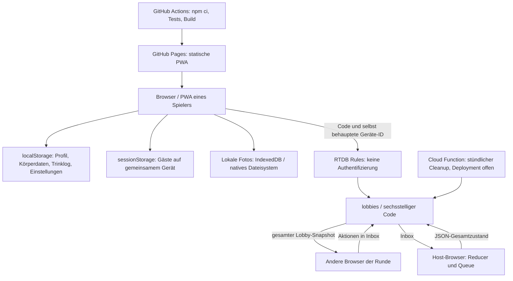
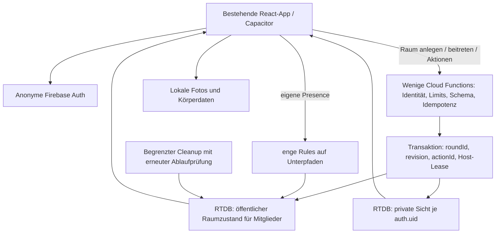

# Pegel – technisches, sicherheitsbezogenes und geschäftliches Release-Audit

> Archivierter Audit vom 1. November 2026. Zugehörige HTML-Berichte, Testskripte, Messwerte und Nachweise liegen vollständig im [Audit-Paket](pegel-audit.zip). Lokale Dateiverweise beziehen sich auf den Inhalt dieses ZIPs.

**Stand und Quellenabruf:** 1. November 2026 · **Repository:** Scientific-Drinking-Game · **geprüfter Commit:** `018c2d33f980bf1b746352fded27267985c21d0d`.

**Entscheidung: NO-GO für eine öffentliche Veröffentlichung des geprüften Stands.** Die bestehende Codebasis ist weiterverwendbar. Eine vollständige Neuentwicklung oder ein Datenbankwechsel ist nach den vorliegenden Befunden nicht erforderlich. Vor einem öffentlichen Launch müssen insbesondere die Lobby-Autorisierung, nachgewiesener Datenverlust bei mehreren Tabs und die Produktpositionierung rund um Alkohol und Fahrtauglichkeit behandelt werden.

Dieser Bericht ist eine technische und organisatorische Vorprüfung, keine juristische, steuerliche oder medizinische Freigabe. Er enthält keine echten Nutzer-, Kontakt- oder Zugangsdaten. Alle zusätzlich angelegten Dateien liegen außerhalb des Anwendungsrepositories unter `/workspace/audit-pegel`. Anwendungscode, Rules und Lockfiles wurden nicht verändert; nichts wurde veröffentlicht oder deployt. Es gab keine Zugriffe auf die Produktionsdatenbank, keine Produktionsschreibvorgänge und keine Cloud-Lasttests.

## Leseschlüssel und Prüfgrenzen

- **NACHGEWIESEN – Test:** Mit vorhandenen Tests, echtem lokalen Browser oder einer ausdrücklich beschriebenen isolierten Reproduktion bestätigt.
- **NACHGEWIESEN – Code:** Die Eigenschaft folgt unmittelbar aus dem geprüften Quellcode beziehungsweise der Konfiguration. Das bestätigt nicht, dass genau diese Konfiguration produktiv deployt ist.
- **UNBESTÄTIGT:** Plausibles Risiko, offene Betriebs-/Rechtsfrage oder noch nicht ausgeführtes Szenario. Keine Behauptung eines bereits eingetretenen Vorfalls.
- **VERBESSERUNG / OPTIONAL:** Architektur- beziehungsweise Komfortmaßnahme ohne belegten Fehler.
- **GUT IMPLEMENTIERT:** Nachweisbar vorhandener Schutz oder funktionierende Komponente, jeweils innerhalb der angegebenen Prüfgrenzen.

Die Inventur umfasst alle **671 versionierten Dateien**, **301 Dateien unter `src/`**, **87 Testdateien**, beide Lockfiles, Rules, Functions, CI, Assets und die lokale Git-Historie mit **124 Commits**. Unter `src/` liegen rund **58.048 Zeilen TypeScript, TSX und CSS**, einschließlich Test- und Inhaltsdaten. Die manuelle Tiefenprüfung konzentriert sich auf Vertrauensgrenzen, zentrale Datenpfade, Multiplayer-Protokoll, Gesundheitsdaten und Releasefunktionen. Nicht jede einzelne Spielkarte wurde redaktionell oder juristisch freigegeben. Eine vollständige Funktions- oder Sicherheitsgarantie ist daraus nicht ableitbar.

**Wesentliche Lücken:** Kein Firebase-Administrationszugriff, keine ausgelesenen deployten Rules, keine Abrechnungs-/Monitoringdaten, keine Gerätefarm, kein macOS/Xcode und keine signierten nativen Artefakte. GitHub-Metadaten bestätigen ein öffentliches Repository; Branch Protection, Secret-Scanning-Konfiguration, Repository-Secrets und Actions-Einstellungen sind über die verfügbaren normalisierten Connector-Daten nicht nachgewiesen. Fehlende Nachweise werden nicht als abgeschaltete Kontrollen ausgegeben.

Die Emulator Suite konnte nicht starten: Der Download des offiziellen Database-Emulators von `storage.googleapis.com` wurde vom ausgehenden Netzwerkproxy mit **HTTP 403** blockiert. Die reproduzierbaren Tests liegen vor, **wurden aber nicht ausgeführt**. Es handelt sich um eine Netzwerkeinschränkung der Audit-Umgebung, nicht um einen Fehler der App.

## A. Executive Summary

| Frage | Begründete Antwort |
|---|---|
| Aktuell veröffentlichungsfähig? | **Nein.** Die im Repository enthaltenen Rules erlauben praktisch vollständige Kontrolle über eine bekannte Lobby ohne Authentifizierung. Zusätzlich wurde Verlust von Trink-Logeinträgen zwischen zwei Tabs nachgewiesen. Store-, Datenschutz- und Rechtefragen sind offen. |
| Architektur grundsätzlich geeignet? | **Ja.** React, TypeScript, lokale Stores, modulare Spieldefinitionen, statische Auslieferung und RTDB passen zu kleinen privaten Spielrunden. Die Vertrauensgrenze zwischen Client und Server ist unzureichend. |
| Kritische Sicherheitslücke? | **Ja, in den geprüften Rules.** Ein Lobby-Code ist zugleich Lese-, Schreib- und Löschberechtigung, einschließlich fremder Spieler und Hostrolle. Die produktive Rules-Version ist unbestätigt. |
| Firebase ausreichend? | Für einen kontrollierten Start grundsätzlich ja. Unter den in E beschriebenen Annahmen sind 1.000 gleichzeitige Nutzer eine sinnvolle Testzielgröße; 10.000 überschreiten im aktuellen Protokoll modellierte Einzelinstanz-Grenzen. Das ist kein gemessener Kapazitätsnachweis. |
| Migration erforderlich? | Keine belegte Notwendigkeit für einen Datenbank- oder Frameworkwechsel. Eine gezielte Ergänzung um vertrauenswürdige Serveraktionen ist sinnvoll. |
| iOS-/Android-Risiken? | Hoher Review-Risikobereich: personalisierte Konsumsteigerung/-erhaltung, positive Alkoholzielwerte, Fahrtauglichkeitsanzeige, sexuelle Zusatzkarten und ungeklärte Meme-Rechte. Keine pauschale Behauptung, jedes Trinkspiel oder jede WebView werde abgelehnt. |
| Rechtliches vor Veröffentlichung? | Gesundheitsbezug der Daten, Datenschutzgrundlagen, Weitergabe der Zone, AV-Verträge/Transfers, tatsächliche Löschung, vollständige Anbieterangaben, Assetrechte, Minderjährige und bei Monetarisierung Gewerbe-/Steuer- und Verbraucherfragen. |
| Was zuerst? | Autorisierung und isolierte Rules-Tests; Tab-Datenverlust; Entscheidung über alkoholneutrales Store-Produkt; danach Multiplayer-Konsistenz, Rechte und Datenschutz, native Integration. |

**Positives Gesamtbild:** 1.048 bestehende Tests bestanden, Lint und TypeScript-/Produktionsbuild erfolgreich. Ein sauberer `npm ci` in einer separaten Kopie erzeugte byteidentische Builddateien. Die Anwendung verfügt bereits über Lazy Loading, einheitliche Spielinterfaces, PWA-Updates mit Nutzerbestätigung, Listener-Cleanup, Heartbeats, Hostwechsel-Transaktion, JSON-Persistenzmigrationen, Datenmengenbegrenzungen und umfangreiche lokale Spieltests. Das ist eine brauchbare Basis; die grünen Tests verdecken allerdings fehlende echte Rules- und Mehrclient-Prüfungen.

## B. Architekturübersicht

### Tatsächlicher Stack

| Bereich | Befund |
|---|---|
| Web | React **19.2.8**, TypeScript, Vite **7.3.6**, React Router **7.18.3**, Zustand; Versionen aus installierten, anschließend sauber reproduzierten Lockfile-Abhängigkeiten |
| Routing | `HashRouter`, öffentliche Rechtstexte, Onboarding-Gate; [src/app/App.tsx:12](https://github.com/PaulWeber-co/Scientific-Drinking-Game/blob/018c2d33f980bf1b746352fded27267985c21d0d/src/app/App.tsx#L12), [src/app/Router.tsx:22](https://github.com/PaulWeber-co/Scientific-Drinking-Game/blob/018c2d33f980bf1b746352fded27267985c21d0d/src/app/Router.tsx#L22) |
| Spiele | **20** Module, gemeinsame Metadaten/Reducer, dynamische Imports; [src/games/registry.ts:41](https://github.com/PaulWeber-co/Scientific-Drinking-Game/blob/018c2d33f980bf1b746352fded27267985c21d0d/src/games/registry.ts#L41) und `:65` |
| Firebase | Firebase JS SDK **12.18.0**, Realtime Database; kein importiertes Firebase Auth, App Check, Firestore, Cloud Storage oder Analytics im Anwendungscode |
| Identität | Zufällige, lokal gespeicherte Geräte-ID; **keine authentifizierte Benutzeridentität**, [src/lib/id.ts:21](https://github.com/PaulWeber-co/Scientific-Drinking-Game/blob/018c2d33f980bf1b746352fded27267985c21d0d/src/lib/id.ts#L21) |
| Backend | Vorhandene Node-24-Cloud-Function `cleanupLobbies`, stündlich, Region `europe-west1`; Deployment nicht bestätigt |
| Hosting/CI | GitHub Pages nach Push auf `main`; separater CI-Workflow für alle Branch-Pushes und Pull Requests mit Typecheck, Lint, Tests und Build; Deploymentworkflow mit eigenen Tests/Build |
| PWA | Manifest und Workbox; App-Shell-Precache, getrennte Bild-Caches, Firebase NetworkOnly, explizite Updatebestätigung |
| Mobile | Capacitor-Core und Plugins für Dateisystem, Haptik, Sharing und lokale Notifications bereits installiert; keine `ios/`, `android/` oder Capacitor-Projektkonfiguration |
| Daten lokal | Profil und Trinklog in localStorage; Gäste in sessionStorage; Fotos via Capacitor Filesystem, im Web IndexedDB |
| Externe Laufzeitdienste | Statische Auslieferung und optional RTDB. Meme-Importskripte kontaktieren Quellen zur Entwicklungszeit; diese Quellen werden beim Spielen nicht aufgerufen. |

Die Ausgangsannahme „Frontend-only“ ist deshalb nur eingeschränkt richtig: Das Spielprotokoll läuft im Frontend, aber eine serverseitige Löschfunktion existiert bereits. Die README nennt teilweise 19 Spiele und vierstellige Codes; tatsächlich sind es 20 Module und sechs Zeichen.

### Ist-Datenfluss und Vertrauensgrenzen



**Vertrauensgrenze 1:** Alles im Browser ist veränderbar, auch `myId`, `isHost`, Altersangaben und Reducer. UI-Prüfungen begrenzen normale Bedienung, begründen aber keine Serverberechtigung.

**Vertrauensgrenze 2:** Die RTDB Rules sind die tatsächlich serverseitige Kontrolle. Ihre Elternfreigabe auf `lobbies/$code` überträgt Zugriffsrechte auf sämtliche Unterknoten. Untergeordnete `.write`-Regeln können eine dort erteilte Freigabe nicht zurücknehmen.

**Vertrauensgrenze 3:** Die Cloud Function verwendet Admin SDK und umgeht Rules. Eingaben aus den Lobbydaten müssen deshalb auch dort begrenzt und bei Löschungen erneut konsistent geprüft werden.

### Datenmodell

```text
lobbies/{CODE}
  meta: code, host, status, gameId, startedBy, startedAt,
        createdAt, updatedAt, expiresAt, film
  players/{deviceId}: id, name, color, drinkIcon, joinedAt,
        lastSeen, online, ready, driver, zone, shots
  avatars/{deviceId}: kleine JPEG-Data-URL bei eingeschalteter Freigabe
  game: id, startedAt, build, state = serialisiertes JSON
  inbox/{pushId}: by, at, action = serialisiertes JSON
```

Körpergewicht, Alter, Größe und das persönliche vollständige Trinklog werden auf den regulären Online-Pfaden nicht hochgeladen. **Die abgeleitete Alkohol-Zone, Spitznamen, Spielantworten und optional Profilbilder werden übertragen.** Das sind weder durchgehend anonyme Daten noch ausschließlich unkritische technische Metadaten. Private Kartenhände liegen derzeit ebenfalls im gemeinsamen Spielzustand.

Alle Browser abonnieren die eigene Lobbywurzel ([src/features/party/PartyContext.tsx:414](https://github.com/PaulWeber-co/Scientific-Drinking-Game/blob/018c2d33f980bf1b746352fded27267985c21d0d/src/features/party/PartyContext.tsx#L414)), der Host zusätzlich die Inbox (`:626`). Der Server liefert bei kleinen Änderungen normalerweise inkrementelle Daten; ein `onValue`-Callback bedeutet **nicht**, dass jedes Mal die komplette Lobby erneut über das Netz geschickt wird. Das Ersetzen des **JSON-Strings** unter `game/state` sendet dagegen bei jeder Änderung wieder diesen ganzen String. Das ist der zentrale Unterschied für die Kostenrechnung.

### Architekturentscheidung

**Wartbarkeit und Codequalität:** TypeScript läuft mit `strict`, `noUnusedLocals` und `noUnusedParameters`; ESLint aktiviert die Hooks-Regeln ausdrücklich ([tsconfig.json:14](https://github.com/PaulWeber-co/Scientific-Drinking-Game/blob/018c2d33f980bf1b746352fded27267985c21d0d/tsconfig.json#L14), [eslint.config.js:18](https://github.com/PaulWeber-co/Scientific-Drinking-Game/blob/018c2d33f980bf1b746352fded27267985c21d0d/eslint.config.js#L18)). Im durchsuchten TS/TSX-Code wurden keine `@ts-ignore`-/`@ts-nocheck`-Unterdrückungen gefunden. Das sind gute Grundlagen, aber keine Laufzeitvalidierung von Netzwerk-JSON. Die Spielmodule nutzen ein gemeinsames Interface; ein nachgewiesener Bedarf, diese Engine neu zu schreiben, besteht nicht.

Der zentrale [src/features/party/PartyContext.tsx](https://github.com/PaulWeber-co/Scientific-Drinking-Game/blob/018c2d33f980bf1b746352fded27267985c21d0d/src/features/party/PartyContext.tsx) umfasst dagegen **1.052 Zeilen** und verbindet Transport, Presence, lokale Runden, Avatarfreigabe, Hostwahl und Spiellogik. Eine Aufteilung in Transportadapter, Protokoll-/Raumlebenszyklus und UI-Context ist eine **Wartbarkeitsverbesserung**, kein eigener Sicherheitsbefund. Sie sollte zusammen mit M03/M04 erfolgen, damit ein bloßes Verschieben von Code keine zusätzliche Migration erzeugt. Wiederholte `.catch(() => {})`-Pfade können Netzwerk-/Löschfehler unsichtbar machen; typisierte Fehlerzustände und sparsame technische Fehlermetriken sind wichtiger als zusätzliche Abstraktionsschichten. Bedeutende Zeit-/TTL-Werte sind in [src/lib/firebase.ts:28–34](https://github.com/PaulWeber-co/Scientific-Drinking-Game/blob/018c2d33f980bf1b746352fded27267985c21d0d/src/lib/firebase.ts#L28-L34) zentralisiert. Ein flächendeckender Duplikat-/Dead-Export-Nachweis wurde nicht erstellt; aus KI-Unterstützung werden weder doppelter Code noch unbenutzte Funktionen behauptet.

| Option | Nutzen für dieses Projekt | Kosten/Aufwand | Urteil |
|---|---|---|---|
| Frontend + RTDB unverändert | Weiterverwendung maximal | Niedrig | Für öffentliche, veränderbare Online-Räume nicht ausreichend |
| Frontend + RTDB + anonyme Auth + engere Rules | Echte Identitäten, Mitgliederrechte, eigene Presence; kein Loginformular nötig | Mittel | Unmittelbar sinnvoll; Host bleibt bei clientseitiger Spielauswertung vertrauenswürdig anzunehmen |
| Zusätzlich Cloud Functions | Raum anlegen/beitreten, Einladungsversuche begrenzen, Spielaktionen prüfen, geheime Hände, Kaufbelege | Mittel; verbrauchsabhängig | **Bevorzugte gezielte Ergänzung**, keine Komplettmigration |
| Cloud Run | Lange Serverprozesse, spezielle serverseitige Spielsimulation, eigene Admission-Control | Mehr Deployment-/Betriebsarbeit | Erst bei gemessenem Bedarf; keine eigene WebSocket-Plattform parallel zur RTDB aufbauen |
| Eigenes Node-Backend | Volle Kontrolle | Eigene Auth-, Patch-, Monitoring-, Backup- und Skalierungsverantwortung | Derzeit kein nachgewiesener Vorteil |
| Firestore | Strukturierte Dokumente/Queries | Datenmodell- und Rules-Migration, andere Abrechnung | Kein Beleg, dass die Räume davon profitieren; viele Echtzeitupdates müssen neu kalkuliert werden |
| Supabase/PostgreSQL | SQL, Auswertungen, Beziehungen, Transaktionen | Migration und Realtime-Neudesign | Für künftiges soziales Produkt denkbar, für heutige Partyräume nicht erforderlich |

**Was Rules allein leisten können:** eigene Player-Pfade, Mitgliedschaft, Hostrechte, gültige Typen, Feldgrenzen, zulässige Zustandsübergänge in einem geeigneten Datenmodell. **Was die aktuellen Rules nicht sinnvoll leisten können:** semantische Prüfung beliebiger Spielzustände in einem JSON-String, verlässliches globales/IP-basiertes Rate Limiting, manipulationsresistente Auswertung im Host-Browser, Store-Kaufverifikation. Verdeckte Informationen müssen in getrennte private Pfade; wenn der Host sie nicht kennen darf, muss die maßgebliche Spiellogik auf einen vertrauenswürdigen Server.



Eine Umstellung kann schrittweise erfolgen: neue Räume unter `lobbiesV2`, Protokollversion in den Daten, alte Räume kontrolliert auslaufen lassen. Den vorhandenen Build-Fingerprint beibehalten, aber um eine explizite Protokollversion ergänzen; er umfasst heute nur Dateien unter `src/games`, nicht die Transportlogik im PartyProvider.

## C. Priorisierte Problem- und Risikoliste

Aufwandsschätzungen sind **Entwicklertage (ET)** eines mit dem Projekt vertrauten Entwicklers, ohne externe Rechtsprüfung, Store-Wartezeiten und ohne Doppelzählung gemeinsamer Änderungen. Keine Festpreisangebote.

| ID | Priorität | Kategorie / Status | Problem | Evidenz | Auswirkung | Aufwand | Empfehlung |
|---|---|---|---|---|---|---|---|
| S01 | **P0** | Security, Code nachgewiesen | Jeder mit Raumcode darf fremde Daten lesen, ändern, übernehmen und löschen | [database.rules.json:10–11](https://github.com/PaulWeber-co/Scientific-Drinking-Game/blob/018c2d33f980bf1b746352fded27267985c21d0d/database.rules.json#L10-L11), [src/lib/firebase.ts:20](https://github.com/PaulWeber-co/Scientific-Drinking-Game/blob/018c2d33f980bf1b746352fded27267985c21d0d/src/lib/firebase.ts#L20) | Vertraulichkeits-, Integritäts- und Verfügbarkeitsverlust ganzer Runden | 3–6 ET Basis; Serveraktionen zusätzlich | Auth, Mitgliederrechte, keine breite Elternfreigabe; Emulator-Negativtests |
| M01 | **P1** | Datenintegrität, Browsertest nachgewiesen | Zweiter Tab überschreibt Trinklog des ersten | [src/store/player.ts:106](https://github.com/PaulWeber-co/Scientific-Drinking-Game/blob/018c2d33f980bf1b746352fded27267985c21d0d/src/store/player.ts#L106), [src/lib/id.ts:21](https://github.com/PaulWeber-co/Scientific-Drinking-Game/blob/018c2d33f980bf1b746352fded27267985c21d0d/src/lib/id.ts#L21); `two-tabs-results.json` | Fehlende Getränke in Persistenz, unvollständige Grundlage der Schätzung | 1–3 ET | Eine schreibende Instanz oder transaktionales lokales Eventjournal |
| S02 | P1 | Abuse, fehlende Kontrollen nachgewiesen | Keine Nutzer-/Raumquoten; beliebig viele Player-/Inbox-Kinder | [database.rules.json:34](https://github.com/PaulWeber-co/Scientific-Drinking-Game/blob/018c2d33f980bf1b746352fded27267985c21d0d/database.rules.json#L34), `:68` | Spam, Überlastung, Kosten; Angriff nicht durchgeführt | 2–5 ET | Raum-/Beitrittskontrolle serverseitig, Größen-/Zeitbudgets und App Check ergänzen |
| S03 | P1 | Spielfairness, Code nachgewiesen | Geheime Hände im für alle lesbaren Gesamtzustand | [src/games/stichmagie/game.ts:229](https://github.com/PaulWeber-co/Scientific-Drinking-Game/blob/018c2d33f980bf1b746352fded27267985c21d0d/src/games/stichmagie/game.ts#L229), [src/games/lueckenfueller/index.tsx:64](https://github.com/PaulWeber-co/Scientific-Drinking-Game/blob/018c2d33f980bf1b746352fded27267985c21d0d/src/games/lueckenfueller/index.tsx#L64), [src/features/party/PartyContext.tsx:414](https://github.com/PaulWeber-co/Scientific-Drinking-Game/blob/018c2d33f980bf1b746352fded27267985c21d0d/src/features/party/PartyContext.tsx#L414) | Teilnehmer können fremde Karten auslesen | 3–7 ET je nach Spielen | Private Spieleransichten und vertrauenswürdige Auswertung |
| M02 | P1 | Nebenläufigkeit, Protokolllücke nachgewiesen; Timing UNBESTÄTIGT | Raumerstellung ist `get` gefolgt von überschreibendem `set` | [src/features/party/PartyContext.tsx:320–354](https://github.com/PaulWeber-co/Scientific-Drinking-Game/blob/018c2d33f980bf1b746352fded27267985c21d0d/src/features/party/PartyContext.tsx#L320-L354) | Zwei Ersteller desselben Codes verlieren die erste Lobby | 0,5–1,5 ET | Atomare Reservierung; nur bei Nichtvorhandensein anlegen |
| M03 | P1 | Nebenläufigkeit, Protokolllücke nachgewiesen | Zustandsschreiben und Inbox-Löschen nicht atomar; `seen` nur im RAM; Nachricht ohne Round-ID | [src/features/party/PartyContext.tsx:625](https://github.com/PaulWeber-co/Scientific-Drinking-Game/blob/018c2d33f980bf1b746352fded27267985c21d0d/src/features/party/PartyContext.tsx#L625), `:652–654`, `:847` | Wiederholung nach Absturz, verspätete Aktion in neuer Runde möglich; Betriebsvorfall UNBESTÄTIGT | 3–5 ET mit M04 | Persistente actionId, roundId, Revision; atomar State und Ack schreiben |
| M04 | P1 | Nebenläufigkeit, Code nachgewiesen | Hostwechsel schützt nur `meta/host`; bereits laufender alter Hostjob ist nicht serverseitig eingezäunt | [src/features/party/PartyContext.tsx:563](https://github.com/PaulWeber-co/Scientific-Drinking-Game/blob/018c2d33f980bf1b746352fded27267985c21d0d/src/features/party/PartyContext.tsx#L563), `:585–614` | Veralteter Host kann neueren Zustand überschreiben | 2–4 ET mit M03 | Host-Epoche/Lease und Versionsprüfung in derselben Transaktion |
| S04 | P1 | Validierung, Code nachgewiesen | `state` und `action` nur Stringlänge, kein JSON-/Spielschemaschutz | [database.rules.json:63](https://github.com/PaulWeber-co/Scientific-Drinking-Game/blob/018c2d33f980bf1b746352fded27267985c21d0d/database.rules.json#L63), `:73`; [src/features/party/PartyContext.tsx:1030](https://github.com/PaulWeber-co/Scientific-Drinking-Game/blob/018c2d33f980bf1b746352fded27267985c21d0d/src/features/party/PartyContext.tsx#L1030) | Beliebige Spielzustände akzeptierbar; konkreter UI-Absturz je Zustand UNBESTÄTIGT | 2–4 ET | Server-Schemas je Aktion und Zustand; Protokollversion |
| R01 | P1 | Store/Produktsicherheit, erhöhtes Review-Risiko | Trinkmengenaufbau, Zielpegel und Fahrtauglichkeitsampel | [src/engine/sips.ts:111–143](https://github.com/PaulWeber-co/Scientific-Drinking-Game/blob/018c2d33f980bf1b746352fded27267985c21d0d/src/engine/sips.ts#L111-L143), [src/features/onboarding/Onboarding.tsx:233](https://github.com/PaulWeber-co/Scientific-Drinking-Game/blob/018c2d33f980bf1b746352fded27267985c21d0d/src/features/onboarding/Onboarding.tsx#L233), [src/features/bac/PegelScreen.tsx:252](https://github.com/PaulWeber-co/Scientific-Drinking-Game/blob/018c2d33f980bf1b746352fded27267985c21d0d/src/features/bac/PegelScreen.tsx#L252) | Ablehnung/Haftungsrisiko; kein behaupteter Reviewentscheid | 3–8 ET Produktumbau | Alkoholneutrale Spielregeln; keine Fahrtauglichkeitsfreigabe oder Konsumoptimierung |
| R02 | P1 | Minderjährige/Inhalte, Code nachgewiesen | Spicy-Schalter prüft nur lokales Alter; Host bestimmt Karten auch für jüngere Geräte | [src/features/games/SpicyToggle.tsx:21–26](https://github.com/PaulWeber-co/Scientific-Drinking-Game/blob/018c2d33f980bf1b746352fded27267985c21d0d/src/features/games/SpicyToggle.tsx#L21-L26), [src/games/shared/prompts.ts:44](https://github.com/PaulWeber-co/Scientific-Drinking-Game/blob/018c2d33f980bf1b746352fded27267985c21d0d/src/games/shared/prompts.ts#L44), [src/features/party/PartyContext.tsx:49](https://github.com/PaulWeber-co/Scientific-Drinking-Game/blob/018c2d33f980bf1b746352fded27267985c21d0d/src/features/party/PartyContext.tsx#L49) | Lokales Altersgate garantiert keinen gruppenweiten Schutz | 1–3 ET plus Inhaltsreview | Lokale Anzeigegrenze und ausdrückliche Gruppenfreigabe; keine Trinkstrafe fürs Ablehnen |
| L01 | P1 | Datenschutz, Übertragung nachgewiesen; Rechtsgrundlage UNBESTÄTIGT | Alkohol-Zone geht regelmäßig mit Identität an RTDB; Art.-9-Bewertung fehlt | [src/features/party/PartyContext.tsx:485–509](https://github.com/PaulWeber-co/Scientific-Drinking-Game/blob/018c2d33f980bf1b746352fded27267985c21d0d/src/features/party/PartyContext.tsx#L485-L509), [src/legal/site.ts:118–125](https://github.com/PaulWeber-co/Scientific-Drinking-Game/blob/018c2d33f980bf1b746352fded27267985c21d0d/src/legal/site.ts#L118-L125) | Sensible Datenverarbeitung, unzutreffende Sicherheits-/Anonymitätsannahme | 1–3 ET + Rechtsprüfung | Zone möglichst entfernen, sonst getrennte ausdrückliche Freigabe und tragfähige Grundlagen |
| L02 | P1 | Rechte, Nachweislücke | 320 Meme-Dateien; Provenienz ist keine kommerzielle Lizenz | [docs/MEME-VORLAGEN-QUELLEN.md](https://github.com/PaulWeber-co/Scientific-Drinking-Game/blob/018c2d33f980bf1b746352fded27267985c21d0d/docs/MEME-VORLAGEN-QUELLEN.md), `public/memes/` | Rechts- und Reviewrisiko; Rechtsverletzung nicht pauschal bewiesen | 2–5 ET Inventar, Ersatz variabel | Rechtekatalog; ungeklärte Motive ersetzen |
| L03 | P1 | Löschung, Betrieb UNBESTÄTIGT | Datenschutzerklärung verspricht zeitnahe Löschung; deployter Cleanup nicht belegt | [src/legal/site.ts:125](https://github.com/PaulWeber-co/Scientific-Drinking-Game/blob/018c2d33f980bf1b746352fded27267985c21d0d/src/legal/site.ts#L125), [functions/index.js:25](https://github.com/PaulWeber-co/Scientific-Drinking-Game/blob/018c2d33f980bf1b746352fded27267985c21d0d/functions/index.js#L25), [firebase.json](https://github.com/PaulWeber-co/Scientific-Drinking-Game/blob/018c2d33f980bf1b746352fded27267985c21d0d/firebase.json) | Aufbewahrung kann Zusagen überschreiten | 1–2 ET | Deployment-/Ausführungsnachweis, Alarm, präzise Fristbeschreibung |
| L04 | P1 | Anbieterangaben, Code nachgewiesen | Im Anschriftfeld fehlt eine Hausnummer; Vollständigkeit nicht belegt | [src/legal/site.ts:88–96](https://github.com/PaulWeber-co/Scientific-Drinking-Game/blob/018c2d33f980bf1b746352fded27267985c21d0d/src/legal/site.ts#L88-L96) | Bei Impressumspflicht unzureichende Erreichbarkeit möglich | <0,5 ET + Prüfung | Ladungsfähige vollständige Anschrift sicherstellen; keine privaten Daten im Audit wiederholen |
| D01 | P1 | Supply Chain, Auditmeldungen nachgewiesen | 47 gemeldete Pakete im Hauptprojekt, 14 im Functions-Lockfile | npm-Audit-JSONs, beide Lockfiles | Unterschiedliche Dev-/Runtime-Risiken; Ausnutzbarkeit nicht pauschal bestätigt | 1–3 ET | Triage, gezielte Updates, Tests; keine blinde `audit fix --force`-Ausführung |
| O01 | P1 | QA/CI, Code nachgewiesen | Vorhandene PR-CI prüft keine echten Rules oder Functions; Multiplayer überwiegend gemockt | [src/features/party/online.test.tsx:65](https://github.com/PaulWeber-co/Scientific-Drinking-Game/blob/018c2d33f980bf1b746352fded27267985c21d0d/src/features/party/online.test.tsx#L65), [.github/workflows/ci.yml:3–21](https://github.com/PaulWeber-co/Scientific-Drinking-Game/blob/018c2d33f980bf1b746352fded27267985c21d0d/.github/workflows/ci.yml#L3-L21), [functions/package.json](https://github.com/PaulWeber-co/Scientific-Drinking-Game/blob/018c2d33f980bf1b746352fded27267985c21d0d/functions/package.json) | Regressionen an Vertrauensgrenzen werden von bisherigen Checks nicht erkannt | 1–3 ET | Bestehende PR-CI um Rules-, Protokoll- und Functions-Prüfungen ergänzen |
| R03 | P1 | Release, Inventur nachgewiesen | Kein natives iOS-/Android-Projekt, keine Signierung/Manifeste | Root-Inventur, [package.json](https://github.com/PaulWeber-co/Scientific-Drinking-Game/blob/018c2d33f980bf1b746352fded27267985c21d0d/package.json) | Noch kein einreichbares Store-Binary | 3–6 ET plus Gerätetests | Capacitor vervollständigen; Details F |
| U01 | P2 | Accessibility, Browsertest nachgewiesen | Dialogfokus wandert in verdeckte Seite | [src/components/ui/index.tsx:55–128](https://github.com/PaulWeber-co/Scientific-Drinking-Game/blob/018c2d33f980bf1b746352fded27267985c21d0d/src/components/ui/index.tsx#L55-L128) | Tastatur-/Screenreaderbedienung erschwert | 0,5–1 ET | Fokus beim Öffnen setzen/einschließen/zurückgeben; Hintergrund inert |
| U02 | P2 | Accessibility, Browsertest nachgewiesen | Kontrastprobleme und unbeschriftetes Datei-Input | [src/styles/tokens.css:23](https://github.com/PaulWeber-co/Scientific-Drinking-Game/blob/018c2d33f980bf1b746352fded27267985c21d0d/src/styles/tokens.css#L23), [src/features/profile/AvatarPicker.tsx:79](https://github.com/PaulWeber-co/Scientific-Drinking-Game/blob/018c2d33f980bf1b746352fded27267985c21d0d/src/features/profile/AvatarPicker.tsx#L79) | WCAG-AA-Anforderungen nicht durchgängig erfüllt | 1–2 ET | Farben je Hintergrund prüfen; Datei-Input benennen |
| M05 | P2 | Verteilung/Zeiten, UNBESTÄTIGT | Hostwahl, Presence, Ablauf und Reihenfolge verlassen sich auf Clientzeit | [src/features/party/PartyContext.tsx:503](https://github.com/PaulWeber-co/Scientific-Drinking-Game/blob/018c2d33f980bf1b746352fded27267985c21d0d/src/features/party/PartyContext.tsx#L503), `:557`, `:633` | Uhrabweichungen, verspätete Events, falsche Hostwahl | 1–2 ET | Serverzeit/Offset für Anzeige, serverseitige Sequenz und Lease |
| M06 | P2 | Lebenszyklus, Code/Reproduktion | Letzter-Teilnehmer-Löschung nutzt alten Snapshot; Cleanup kann neu angelegten Ersatzraum löschen | [src/features/party/PartyContext.tsx:680–685](https://github.com/PaulWeber-co/Scientific-Drinking-Game/blob/018c2d33f980bf1b746352fded27267985c21d0d/src/features/party/PartyContext.tsx#L680-L685); [functions/index.js:14–19](https://github.com/PaulWeber-co/Scientific-Drinking-Game/blob/018c2d33f980bf1b746352fded27267985c21d0d/functions/index.js#L14-L19) | Seltene Löschrennen; Cleanup mit Fake-DB reproduziert | 1–2 ET | Transaktion mit Raumgeneration und erneut geprüfter Ablaufzeit |
| P01 | P2 | Skalierung, Code nachgewiesen | Jeder Zug ersetzt ganzen JSON-State; jede Lobbyänderung aktualisiert zentralen Context | [src/features/party/PartyContext.tsx:414](https://github.com/PaulWeber-co/Scientific-Drinking-Game/blob/018c2d33f980bf1b746352fded27267985c21d0d/src/features/party/PartyContext.tsx#L414), `:613` | Traffic und Rendering steigen mit Zustand, Teilnehmern und Aktionsrate | 2–4 ET | Messen, öffentliche/private Pfade, kleinere Zustände, fokussierte Abos |
| P02 | P2 | Performance, Labortest nachgewiesen | LCP ungefähr 8,5 s bei vereinbartem langsamen Netz-/CPU-Profil | [src/features/games/GameCard.tsx:52](https://github.com/PaulWeber-co/Scientific-Drinking-Game/blob/018c2d33f980bf1b746352fded27267985c21d0d/src/features/games/GameCard.tsx#L52), [src/app/Router.tsx:4–13](https://github.com/PaulWeber-co/Scientific-Drinking-Game/blob/018c2d33f980bf1b746352fded27267985c21d0d/src/app/Router.tsx#L4-L13); `evidence/performance.json` | Langsamer erster sichtbarer Hauptinhalt; kein Produktions-Feldwert | 1–3 ET | Kleinere Bildvarianten, erstes sichtbares Motiv priorisieren; identisch nachmessen |
| O02 | P2 | Betrieb, Nachweislücke | Kein überprüfbares Staging-/Backup-/Alerting-Konzept | [firebase.json](https://github.com/PaulWeber-co/Scientific-Drinking-Game/blob/018c2d33f980bf1b746352fded27267985c21d0d/firebase.json), Workflows, [src/lib/firebase.ts:13](https://github.com/PaulWeber-co/Scientific-Drinking-Game/blob/018c2d33f980bf1b746352fded27267985c21d0d/src/lib/firebase.ts#L13) | Unbemerkte Fehler/Kosten, erschwerte Wiederherstellung | 1–3 ET | Schlanker Betriebsplan in I |
| O03 | P3 | Dokumentation | README widerspricht aktuellem Funktions-/Datenumfang | README versus Registry, [src/features/party/PartyContext.tsx:442](https://github.com/PaulWeber-co/Scientific-Drinking-Game/blob/018c2d33f980bf1b746352fded27267985c21d0d/src/features/party/PartyContext.tsx#L442) | Fehlentscheidungen bei Review und Datenschutz | 0,5–1 ET | Dokumentation aus realem Dateninventar aktualisieren |

### Konkrete Reproduktionen und Abnahmekriterien

**S01/S02/S04 – Zugriffe ohne Identitätsnachweis.** Nach den vorhandenen Rules genügt ein sechsstelliger gültiger Pfad. Anlegen einer gültigen Lobby, Lesen des gesamten Raums, Ersetzen von `meta/host`, Schreiben auf `players/<fremde-id>/name`, Setzen von `game/state` auf einen beliebigen kurzen String und Löschen des Raums sind durch die Elternregel autorisiert. Bei Löschung greifen `.validate`-Regeln nicht als Löschschutz. Die Root-Regel verhindert zwar das Auflisten sämtlicher Lobbys; sie verhindert nicht den Einzelzugriff auf einen bekannten oder erratenen Code. Das Script `tests/rules-audit.mjs` enthält diese Fälle und negative Kontrollen für unzulässige Felder/Überlängen. Es ist ausschließlich auf `127.0.0.1:9000` und ein `demo-`-Projekt eingestellt. **Nicht ausgeführt wegen Emulator-Downloadblockade.** Nach der Korrektur müssen nicht autorisierte Reads/Writes/Löschungen scheitern; erlaubte eigene Aktionen müssen funktionieren. Ein bloß längerer Code behebt das Rechteproblem nicht.

**M01 – echter Tab-Datenverlust.** Zwei Tabs desselben Browserkontexts laden dasselbe leere Profil. Tab A trägt über „Getränk eintragen“ ein Glas ein. Tab B trägt anschließend ein Glas ein, ohne neu zu laden. Erwartung: zwei Ereignisse. Ergebnis: **ein Ereignis, erste ID nicht mehr vorhanden**. Beide Tabs besitzen eigene Zustand-Instanzen; `persist` schreibt jeweils den eigenen Gesamtstand in denselben Storage-Key. Es existiert keine tabübergreifende Synchronisation. Das kann über verlorene Getränke indirekt auch eine zu niedrige Schätzung erzeugen; dieser Folgeeffekt wurde nicht als medizinische Messung getestet. Lösung: entweder zweite schreibende Instanz blockieren (mit robuster Ownership/Lease), oder append-only Events in IndexedDB mit eindeutigen IDs und Transaktionen; BroadcastChannel allein ist keine Transaktion. Abnahme: parallel 100 Events, alle genau einmal; Reload, Tababsturz, Undo und Nachtwechsel erhalten Konsistenz.

**M02 – Raumerstellung.** Zwei Clients erhalten für denselben noch freien Code einen leeren `get`-Snapshot. Beide `set`-Aufrufe sind zulässig; der zweite ersetzt die erste Lobby. Das Kryptozufallsverfahren reduziert Kollisionswahrscheinlichkeit, beseitigt das Race nicht. Lösung: `runTransaction`/serverseitige Transaktion, die nur bei `current === null` anlegt; begrenzte Wiederholungen bei Kollision. Bei Client-Transaktionen keine zufällige Neuberechnung im Retry-Callback. Ein Testszenario erzwingt denselben Code, statt auf einen zufälligen Treffer zu warten.

**M03/M04 – Aktion, Ack und Autorität.** Ein Host schreibt den neuen State (`:613`), stürzt vor `remove(inbox/key)` ab (`:654`), und ein neuer Host liest die Nachricht erneut. Das flüchtige `seen`-Set kennt sie nicht. Nicht idempotente Aktionen können doppelt wirken. Zusätzlich enthält die transportierte Nachricht keine Round-ID; ein verspäteter Offline-Push kann nach Start einer anderen Runde ankommen. Die Hostrolle wird zu Beginn des Effects geprüft, aber der bereits gestartete asynchrone Job erhält keine serverseitige Absicherung gegen eine inzwischen gewechselte Rolle. Diese Protokollpfade sind im Code belegt, die zeitlichen Abläufe wurden nicht mit echten Firebase-Clients ausgeführt.

Zielstruktur, als **Entwurf**, nicht als angewendeter Patch:

```ts
type ActionEnvelope = {
  roomId: string;
  roomGeneration: string;
  roundId: string;
  actionId: string;
  expectedRevision: number;
  type: string;
  payload: unknown;
};
// Im vertrauenswürdigen Handler:
// Identität aus Auth, nicht aus payload.by.
// Mitgliedschaft, Schema, erlaubte Aktion, Runde und Revision prüfen.
// State + neue Revision + verarbeitete actionId atomar persistieren.
// Wiederholte actionId liefert dieselbe Antwort, ohne die Aktion erneut auszuführen.
```

**M06 – präzise Reichweite des Löschrennens.** Ein gewöhnlicher Client kann eine bereits abgelaufene Lobby nach den vorhandenen Rules nicht einfach verlängern. Das isoliert reproduzierte Problem betrifft einen inzwischen **gelöschten und unter demselben Code neu angelegten Ersatzraum**, nachdem der Cleanup seinen Query-Snapshot aufgenommen hat. Die Function löscht anschließend nur anhand des Codes. Das ist selten, aber mit einer unveränderlichen Raumgeneration und einer transaktionalen erneuten Prüfung behebbar. Zusätzlich kann `leave()` eine gerade beitretende Person übersehen, wenn der lokale Snapshot noch keinen weiteren Spieler enthält.

**R02 – tatsächliche Altersgrenze.** Die Prüfung `age < 18` verbirgt den Schalter auf dem lokalen Gerät. Die Deck-Erstellung liest aber die Einstellung des startenden Geräts, und die Online-Spielerliste führt keine gruppenweite Inhaltsfreigabe. Ein jüngerer Teilnehmer kann damit Inhalte eines von einem Erwachsenen gestarteten Spicy-Spiels erhalten, ohne selbst einen Schalter manipuliert zu haben. Die technische Schutzlücke ist belegt; welche Inhalte rechtlich oder im Store unzulässig sind, muss einzeln geprüft werden. Ein geeignetes Design fragt nach Inhaltsfreigabe, nicht nach Übertragung vollständiger Geburtsdaten.

## D. Security-Bericht und tatsächlich ausgeführte Prüfungen

### Sicherheitslage und Angriffsvoraussetzungen

| Bereich | Bewertung, Bedingung und Nachweis | Maßnahme |
|---|---|---|
| Broken Access Control / IDOR | Kritisch: Kenntnis eines gültigen Lobby-Codes genügt; kein Auth-Token erforderlich. S01. | UID-basierte Mitgliedschaft und untergeordnete Schreibrechte |
| Authentication / Session | Kein Accountsystem; lokale Geräte-ID ist kein Token. Behauptete IDs lassen sich direkt setzen, Inbox-`by` ist nicht gebunden. | Anonyme Auth genügt für den Start; Gerätekennung nur als UI-/Installationsmerkmal |
| Privilegieneskalation | `meta/host` ist wie andere Felder frei beschreibbar. Clientseitiges `isHost` schützt die API nicht. | Serverentscheidung über Hostwechsel, Lease-Epoche |
| Vertrauliche Spielinformationen | Kartenhände werden gemeinsam repliziert. Auch korrekte Auth allein würde das nicht beheben. | Private Pfade/Sichten; Server übernimmt notwendige Geheimhaltung |
| Eingabevalidierung | Typ-/Längen-/Feldlisten sind vorhanden, aber Anzahl und semantisches JSON fehlen. | Schemata für bekannte Aktionen, Feldgrenzen und Gesamtbudgets |
| XSS | Kein belegter XSS-Pfad. Keine produktiven `dangerouslySetInnerHTML`-/`innerHTML`-Sinks in den durchsuchten Quellen gefunden; React rendert Texte regulär escaped. | Beibehalten; individuelle URL-/Avatar-/UGC-Pfade weiter negativ testen |
| Injection / SSRF | Keine SQL-Abfragen, kein frei wählbarer serverseitiger Fetch-Endpunkt im untersuchten Laufzeitcode. Kein Nachweis einer SQL-Injection oder SSRF. | Beim späteren Backend neue Angriffsfläche ausdrücklich prüfen |
| Dateiuploads | Avatar wird lokal zu JPEG verarbeitet und begrenzt. Rules prüfen Data-URL-Präfix/Länge, keine tatsächliche Dekodierbarkeit. Elternfreigabe gilt auch hier. | Eigener Avatarpfad, sichere Bildprüfung falls serverseitig verarbeitet; kein unnötiger Uploaddienst |
| Secrets | 1.287 lokale historische Textblobs auf erkennbare Private-Key-, GitHub-Token-, AWS-Key- und Service-Account-Formate geprüft: kein Treffer. Kein vollständiger Entropie-/Provider-Scan. | GitHub Secret Scanning verifizieren; bei tatsächlichem Fund erst widerrufen, dann Historie bereinigen |
| API-Key/DB-URL | Datenbankadresse ist öffentlicher Client-Konfigurationswert, kein kompromittiertes Secret. Kein Schlüssel muss allein wegen dieser URL rotiert werden. | Zugriff mit Rules absichern, keine „URL verstecken“-Scheinlösung |
| Transport/Headers | SDK-URL verwendet HTTPS. In Repository/HTML keine CSP-Konfiguration; produktive Response-Header nicht geprüft. | CSP/Referrer-Policy/Permissions-Policy am gewählten Hosting prüfen; keine Behauptung fehlender produktiver HSTS |
| Abuse/Kosten | Kein App-Check-Code, kein verifizierter Enforcementschutz, keine API-Ratelimits. Sechsstellige Codes sind kein generelles Schutzsystem. | App Check als Zusatz, serverseitige Erstell-/Joinlimits, Kapazitäts- und Budgetalarme |
| Native Sicherheit | Aktuell keine nativen Projekte. Zertifikate, Keychain/Keystore, Backup-Ausschlüsse, WebView-Bridge und Release-Debugging noch nicht prüfbar. | MASVS-orientierter Durchgang nach Capacitor-Integration |

Die Prüforientierung ist [OWASP Top 10 2025](https://owasp.org/projects/top-ten), [ASVS 5.0.0](https://asvs.owasp.org/) und für die spätere native App [OWASP MASVS](https://mas.owasp.org/MASVS/). Das ist keine Behauptung einer vollständigen ASVS-/MASVS-Konformitätsprüfung. Relevant sind insbesondere Zugriffskontrolle, sichere Architektur, Konfiguration, Supply Chain, Validierung, Fehlerbehandlung und Logging. Eine isolierte Auswahl von Tests ersetzt keine normative Anforderungsmatrix.

### Acht konkret angefragte Rechteprüfungen

Bewertung gilt für **Repository-Rules**, nicht für unzugängliche produktive Konfiguration:

| Kann ein normaler/unauthentifizierter Nutzer … | Ergebnis |
|---|---|
| Andere Nutzer lesen? | **Ja**, innerhalb eines bekannten Raumcodes; kein globales Listing aller Räume. |
| Andere Nutzer verändern? | **Ja**, unter Beachtung der vorhandenen Feld-/Typvalidierung. |
| Fremde Sessions übernehmen? | **Ja**, Hostfeld und Spielzustand können überschrieben werden. |
| Administrative Funktionen auslösen? | Hostähnliche Spielfunktionen ja; kein Nachweis eines Zugriffs auf GCP-IAM, Scheduler-Verwaltung oder Firebase-Admin-API. |
| Fremde Daten löschen? | **Ja**, die Elternfreigabe und explizite Löschbedingung erlauben dies. |
| Eigene Rechte erhöhen? | **Ja**, Hostrolle frei setzbar; keine tatsächliche Identitätsbindung. |
| Unbegrenzt Daten erzeugen? | Praktisch unbeschränkt durch Nutzer-/Zeitquoten; technische RTDB-/Schlüssel-/Payloadgrenzen bleiben bestehen. |
| Ungültige/übergroße Daten einschleusen? | Ungültiges JSON innerhalb erlaubter Stringlänge ja; einzelne Überlängen/unerwartete Felder werden begrenzt, Gesamtkindanzahl nicht. |

### Dependency- und Buildprüfung

| Prüfung | Tatsächliches Ergebnis | Aussagegrenze |
|---|---|---|
| `npm test` | **87 Dateien, 1.048 Tests bestanden**, 103,58 s | Unit-/Komponententests; Multiplayer größtenteils Mocks |
| `npm run lint` | Exit 0 | Kein Sicherheitsbeweis |
| `npm run build` | TypeScript + Vite erfolgreich | Keine native Kompilierung |
| Sauberer Install-/Buildlauf | `npm ci --ignore-scripts`, anschließend Build in separater Kopie erfolgreich; **390/390 Dateien byteidentisch** | Linux/Node 24; kein plattformübergreifender Reproduzierbarkeitsbeweis |
| `npm audit` Hauptprojekt | **47 Paketmeldungen:** 2 kritisch, 18 hoch, 21 mittel, 6 niedrig | Transitive Sammelmeldungen, keine 47 unabhängigen ausnutzbaren App-Lücken |
| `npm audit --omit=dev` | **5 hohe Paketmeldungen** | Firebase/Firestore-Abhängigkeitszweig; Firestore nicht von der App importiert |
| `npm audit` Functions | **14 Paketmeldungen:** 3 hoch, 11 mittel | Deployment und konkrete Ausnutzbarkeit offen |
| Lokaler historischer Musterscan | 1.287 Textblobs, kein Treffer der geprüften Credentialformate | Nur lokal erreichbare Historie; keine GitHub-Secrets/gelöschten Remote-Refs |
| Zusätzliche Stategrößen-Prüfung | 20 reale `createState`-Funktionen ausgeführt; **140–4.378 UTF-8-Bytes** bei sechs synthetischen Spielern | Initialzustände, keine über Stunden gewachsenen Zustände |
| Browser | Chromium, sechs Ansichten und drei weitere Breiten; keine JavaScript-Pageerrors in diesen Flows | Kein Safari-/Android-/iOS-Hardwaretest |
| Zwei Tabs | **Datenverlust reproduziert** | Lokale Browserpersistenz, keine Firebase-Verbindung |
| Cleanup-Race | Originalfunktion im isolierten VM-Harness mit Fake-DB: Ersatzraum wird gelöscht | Kontrollierte Interleaving-Reproduktion, kein Firebase-Test |
| Rules-Emulator | 20 Fälle vorbereitet; **nicht ausgeführt** | Emulator-Download HTTP 403 |
| Last/Kapazität | **Keine Produktions- oder Staginglasttests** | Nur Rechenmodell und ausformulierter Plan |

Die beiden kritischen npm-Sammelmeldungen betreffen **Vitest/Tinypool im Entwicklungszweig**. Tinypool-Advisories beschreiben RCE-Gadgets unter zusätzlichen Bedingungen wie Prototype Pollution/gefährlichen Workeroptionen; daraus folgt keine Browser-RCE in der veröffentlichten PWA. Die fünf Produktionsmeldungen laufen über `firebase → @firebase/firestore → @grpc/grpc-js/re2js`. Im Appcode wird RTDB verwendet. Erreichbarkeit und ausgelieferte Module müssen getrennt von der Lockfilemeldung beurteilt werden. In Functions sind unter anderem Express/body-parser betroffen; der vorhandene Export ist eine geplante Cleanup-Funktion, kein selbst definierter öffentlicher Formularendpunkt. Trotzdem sind zeitnahe geprüfte Updates sinnvoll.

Die konkreten Advisory-URLs und betroffenen Versionen stehen in den Audit-JSONs. Beispiele: [Tinypool](https://github.com/advisories/GHSA-5gmw-xhrv-c9v3), [Vitest Mocker](https://github.com/advisories/GHSA-82fw-gwwq-j7x9), [RE2JS](https://github.com/advisories/GHSA-gg6h-894w-4m9c). Kein Lockfile wurde durch das Audit geändert.

Lockfile-Lizenzmetadaten sind überwiegend MIT/Apache/BSD/ISC; außerdem sind u. a. BlueOak, Python-2.0 und CC-BY-4.0 enthalten. Keine Copyleft-Inkompatibilität wurde damit nachgewiesen. Eine SBOM und NOTICE-Zusammenstellung müssen direkte und tatsächlich ausgelieferte transitive Komponenten getrennt erfassen. **Die Bildrechte sind davon unabhängig.** Lokal mitgelieferte Schriftlizenzen sind positiv vorhanden.

### Automatisierte Tests und Testpyramide

Die bestehende Testbasis sollte erhalten bleiben. Priorität haben ergänzende Tests an den bisher nicht geprüften Grenzen:

| Ebene | Konkrete Fälle | Abnahmekriterium |
|---|---|---|
| Unit | Reducer, Grenzen/ungültige Aktionen, Zeit-/Round-ID-Wechsel, lokale Eventjournal-Merges | Keine mutierbaren Fremdzustände; nachvollziehbare Fehler statt stiller Beschädigung |
| Rules positiv | Authentifizierter Raumersteller, Mitglied liest öffentlichen State, eigene Presence, eigene erlaubte Aktion, eigener Austritt | Legitime Wege funktionieren mit echten Rules |
| Rules negativ | unauthentifiziert, anderer Raum, fremder Playerpfad, fremder Avatar, fremde Hand, gefälschter Absender, Hostübernahme, zu große Payload/Anzahl, unbekannte Felder | Alle unzulässigen Versuche werden vom Emulator abgewiesen |
| Protokollintegration | Zwei gleichzeitige Create/Start-Aktionen, duplicate actionId, alter Host nach Failover, Ackverlust, verspätete Inbox-Nachricht nach Rundenwechsel | Genau eine Zustandsänderung pro Aktion, keine alte Runde wird verändert |
| Lebenszyklus | Offline beim Join, Timeout und spätes ACK, Reconnect, App-Kill, letzter Teilnehmer gegen gleichzeitigen Join, TTL/Cleanup gegen neue Raumgeneration | Keine Geisterräume, keine unbemerkten Löschungen oder verspäteten Schreibungen |
| Browser-E2E | Alters-/Modus-Onboarding, Pass & Play, Einladung, zwei Browserkontexte, zwei Tabs, Löschen/Reset/Export | Kritische Journeys einschließlich Wiederanlauf erfolgreich |
| Native | App im Hintergrund, Telefonanruf, Kamera-/Notification-Berechtigung abgelehnt, Filesystem voll, Upgrade, Kaufrestore | Kontrollierter Zustand und verständliche Fehlermeldungen |
| Accessibility | Tastatur, VoiceOver/TalkBack, 200 % Text, Kontrast hell/dunkel, reduzierte Bewegung, 320 px und Querformat | WCAG-2.2-AA-Ziel und Plattformbedienbarkeit überprüft |
| CI | Bestehende Pull-Request-Prüfungen für install, lint, types, unit und build um Rules/Functions und kleine E2E-Suite ergänzen; signierter Build vor Release | Veröffentlichung erst mit vollständigen relevanten Checks |

Registrierungs-/Passwortresettests sind heute **nicht relevant**, weil keine Konten existieren. Nach anonymer Auth werden Tokenwechsel, gelöschter Browserzustand, Authfehler und späteres Verknüpfen eines Kontos relevant. Bloßes Testen einer sichtbaren UI-Sperre reicht bei keiner Berechtigung aus.

Die vorhandenen Listener werden überwiegend sauber abgemeldet; Timer und Sichtbarkeitslistener werden bereinigt. Ein genereller Listener-Leak ist **nicht nachgewiesen**. `withTimeout` beendet allerdings nur das Warten, nicht den Firebase-Schreibauftrag ([src/lib/firebase.ts:36](https://github.com/PaulWeber-co/Scientific-Drinking-Game/blob/018c2d33f980bf1b746352fded27267985c21d0d/src/lib/firebase.ts#L36)). Ein verspätet bestätigter Auftrag nach angezeigtem Timeout ist deshalb als eigener Integrationstest notwendig.

## E. Skalierung, Performance und Kosten

### Gemessene Frontend-Eigenschaften

| Messgröße | Ergebnis | Einordnung |
|---|---:|---|
| Gesamter Produktionsordner | 10.720.178 Bytes, 390 Dateien | Enthält alle Spiele und 320 Meme-Dateien; nicht gleich initialer Download |
| Workbox-Precache | 51 Einträge, 1.256,55 KiB | Enthält auch Spielchunks; Lazy Loading reduziert die erste Ausführung, nicht zwingend alle späteren SW-Downloads |
| Hauptchunk | 269.631 Bytes roh / 92.504 Bytes gzip | Profil, Kamera, Pegel und andere Hauptscreens werden statisch importiert |
| React/Router/Zustand-Chunk | 235.113 / 75.392 Bytes | Getrennt cachebar |
| Firebase-Chunk | 162.579 / 48.551 Bytes | Netzwerkinitialisierung erst bei Online-Nutzung; Code kann trotzdem im initialen Modulgraph sein |
| Meme-Spielchunk | 115.146 / 28.949 Bytes | Separat geladen |
| 20 Spielmotive | 3.732.560 Bytes insgesamt | README-/Konfigurationskommentare mit ungefähr 1 MB sind veraltet |
| 320 Meme-Vorlagen | 5.674.972 Bytes insgesamt | Lokal ausgeliefert, nicht in RTDB gespeichert |
| Anfänglicher Spielzustand, sechs synthetische Spieler | 140–4.378 Bytes UTF-8 | Reale `createState`-Funktionen; späteres Wachstum nicht damit gemessen |

**Lokaler Performanceversuch:** drei frische Chromium-Kontexte, 390 × 844 px, CPU-Verlangsamung Faktor 4, Download 1,6 Mbit/s, 150 ms Latenz, Produktionsbuild über lokalen Vite-Preview. Service Worker für reproduzierbare Kaltstarts blockiert; keine externen Requests erlaubt. Die Startübersicht übertrug **2.559.532 Bytes in 20 Ressourcenrequests**. FCP lag bei etwa **1,95–1,98 s**, LCP bei ungefähr **8,5 s**. Rohdaten: `evidence/performance.json`.

Das ist ein **synthetischer Labortest ohne CDN-Kompression**, kein Lighthouse-Score, keine Core-Web-Vitals-Felddaten und kein Messwert eines echten iPhones. Er belegt dennoch ein relevantes Optimierungsziel: große sichtbare Spielmotive und die erste Übersicht auf langsamen Verbindungen. Vorher/nachher unter derselben Drosselung messen. Sinnvoll sind passende kleine Bildvarianten/`srcset`, feste Bildabmessungen, Priorisierung des ersten sichtbaren Motivs sowie bei Bedarf Lazy Loading von Kamera/Album/Profil. Keine pauschale weitere Frameworkmigration.

**Zusatzbefund P02, P2, NACHGEWIESEN – Labortest:** langsamer LCP unter obigen Bedingungen. Betroffen: `src/assets/games/`, [src/features/games/GameCard.tsx:52](https://github.com/PaulWeber-co/Scientific-Drinking-Game/blob/018c2d33f980bf1b746352fded27267985c21d0d/src/features/games/GameCard.tsx#L52), [src/app/Router.tsx:4–13](https://github.com/PaulWeber-co/Scientific-Drinking-Game/blob/018c2d33f980bf1b746352fded27267985c21d0d/src/app/Router.tsx#L4-L13). Aufwand 1–3 ET. Abnahmeziel beispielsweise LCP <2,5 s auf einem vereinbarten Referenzprofil; erst messen, ob kleinere Bilder dafür genügen. Der Wert ist ein Ziel, keine zugesagte Verbesserung.

Nicht gemessen: langfristiger Heapverbrauch, Akkulaufzeit, Wärmeentwicklung, Safari-GPU-Verhalten, native Kaltstarts und echtes Funknetz. Canvas/Glasphysik und Timer verdienen einen Test auf älteren Geräten. Im Code sind Abbruch/Neustart von Animationsframes und reduzierte Bewegung berücksichtigt; ein Akku- oder Speicherleck ist nicht nachgewiesen.

### UI/UX und Accessibility: beobachtete Qualität und Grenzen

Die Oberfläche besitzt mobile Navigation, konsistente Sheets, Haptik-Anbindung, dunkles/helles Theme, Safe-Area-Variablen und Regeln für reduzierte Bewegung. Sie ist erkennbar für mobile Nutzung gestaltet. Das belegt jedoch noch keine native Gerätequalität. [src/styles/tokens.css:129–141](https://github.com/PaulWeber-co/Scientific-Drinking-Game/blob/018c2d33f980bf1b746352fded27267985c21d0d/src/styles/tokens.css#L129-L141) enthält Safe Areas und Themewechsel; [src/styles/global.css:200](https://github.com/PaulWeber-co/Scientific-Drinking-Game/blob/018c2d33f980bf1b746352fded27267985c21d0d/src/styles/global.css#L200) berücksichtigt reduzierte Bewegung. Spielmotive sind bereits `loading="lazy"`, und ihre Animationen folgen einem bereinigten IntersectionObserver ([src/features/games/GameCard.tsx:52](https://github.com/PaulWeber-co/Scientific-Drinking-Game/blob/018c2d33f980bf1b746352fded27267985c21d0d/src/features/games/GameCard.tsx#L52), `:78`); der Performancebefund verlangt deshalb passende Bildgrößen/Prioritäten, nicht die Behauptung, Lazy Loading fehle überall.

| Geprüfter Bereich | Beobachtung / Grenze |
|---|---|
| Onboarding, Übersicht, Lobby, Pegel, Profil, Meme-Spielseite | In Chromium 154.0.8037.57 lokal aufgerufen; keine JavaScript-Pageerrors in diesen Flows. Kein vollständiger Durchlauf aller 20 Spiele. |
| Kleine Displays und Querformat | Übersicht bei 320 px, 768 px und 844 × 390 px ohne horizontales Überlaufen. Keine Garantie für alle Dialog-/Tastaturkombinationen. |
| Kontrast, axe mit WCAG-Tags | Lobby: 4 betroffene Elemente; Pegel: 4; Profil: 10. Profil zusätzlich 1 unbenanntes Datei-Input. Null automatisierte Treffer auf einzelnen anderen Ansichten bedeutet keine vollständige WCAG-Konformität. |
| Konkrete Kontrastbeispiele | Gedämpfter Text im dunklen Theme etwa 3,45:1 bei geforderten 4,5:1; ein kleiner Profiltext etwa 1,78:1. Selektoren, Farben und Schriftgrößen stehen in `evidence/browser-results.json`. |
| Modalbedienung | Im geöffneten Spicy-Sheet landeten **10 von 12 Tab-Schritten außerhalb** des Dialogs. Escape/Scrollsperre/Cleanup existieren, Fokusfalle, initialer Fokus und Rückgabe sind nicht implementiert. |
| Fehlermeldungen und Ladezustände | Online-Timeouts und UI-Rückmeldungen sind vorhanden; verspätete Netzwerkaufträge sowie still behandelte Fehler brauchen die beschriebenen Integrationstests. Eine vollständige Offline-/Permission-Fehlermatrix wurde nicht durchlaufen. |
| Noch offen | VoiceOver/TalkBack, echte 200-%-Schriftvergrößerung, Touch-Zielgrößen über sämtliche Screens, beide Themes vollständig, Softkeyboard/Notch, Tablet-Multitasking und native Hintergrund-/Resumezustände. |

U01 und U02 sind konkrete Bedienungsfehler, keine bloße Stilpräferenz. Das axe-Wort „critical“ beim unbeschrifteten Input ist eine Accessibility-Werkzeugbewertung und wird nicht mit einem kritischen Security-CVE gleichgesetzt. Vor Release sollten eine reale Person mit Tastatur/Screenreader und mindestens ein kleines Gerät die wichtigsten Journeys prüfen.

### Multi-User-Isolation und Gleichzeitigkeit

**Normale unabhängige Räume:** Pfade sind nach Raumcode getrennt. Es wurde kein globaler Spielzustand gefunden, der bei gewöhnlicher Benutzung automatisch alle Räume vermischt. **Sicherheitsisolation:** fehlt, sobald ein anderer Raumcode bekannt ist. Diese zwei Aussagen dürfen nicht verwechselt werden.

Die lokale Hostqueue verhindert parallele Jobausführung innerhalb **einer** Providerinstanz. Sie schützt nicht zwei Host-Tabs mit derselben Geräte-ID, zwei Geräte während eines Rollenwechsels oder externe SDK-Aufrufe. `runTransaction` ist bei Hostübernahme vorhanden, wird aber nicht auf den eigentlichen Spielzustand angewendet. Das startende Gerät kann eine Runde mit einem atomaren Multi-Path-Update erzeugen; mehrere konkurrierende Starts bleiben ohne Vergleich der erwarteten Version möglich.

### Rechenannahmen – bewusst kein gemessener Traffic

Die Kosten sind mit `tests/model.py` reproduzierbar. Alle folgenden Werte sind **Planungsannahmen**, außer den ausdrücklich als Code-/Preismessung bezeichneten Angaben:

- Sechs Online-Spieler pro Raum, 90 Minuten pro Session, vier Online-Sessions pro aktivem Nutzer und Monat. MAU umfasst in diesem Modell ausschließlich entsprechend aktive Online-Spieler; bei 25 % Online-Anteil sinken variable Datenbankwerte ungefähr auf ein Viertel.
- Ein Spielzustandswechsel pro Raum alle fünf Sekunden, also 1.080 Aktionen pro Session. Fünf Sechstel stammen von Gästen und erzeugen zusätzlich einen Inbox-Push und ein Ack/Löschen. Batching ist für die obere Planung nicht eingerechnet.
- **8.192 Bytes State pro Aktion** als vorsichtiger Arbeitswert für gewachsene Runden; gemessene Initialzustände sind kleiner. An der Rules-Grenze sind bis zu 200.000 Zeichen möglich, bei nicht-ASCII-Inhalt entsprechend mehr Bytes.
- Heartbeat je Spieler alle 20 Sekunden, Host-Metadaten alle 40 Sekunden – diese Intervalle stehen tatsächlich im Code. Pro Playerupdate angenommen 200 Bytes, Hostupdate 150 Bytes, Inbox inklusive Löschung 350 Bytes je Gastaktion.
- Einmalig sechs Avatar-Daten-URLs à 20.000 Bytes plus 30.000 Bytes Initial-/Verbindungsdaten je Teilnehmer. Faktor 1,3 als **angenommener** Protokoll-/Sicherheitsaufschlag; tatsächliche TLS-, Reconnect- und Broadcastkosten müssen gemessen werden.
- Daraus **rund 12,55 MB Download je Spieler-Session**, rund 75,32 MB je Sechserrunde und **4.635 logische Writes pro Raum-Session**. Das entspricht ungefähr 0,0126 USD variablen RTDB-Downloadkosten je Teilnehmer-Session vor Freimengen, nicht dem Preis einer Datenbankoperation.

RTDB berechnet Downloadvolumen und gespeicherte Daten, nicht einfach einen festen Betrag pro Read/Write. Ein zweites überlappendes Host-Inbox-Abo wird nicht ohne Messung als doppelte vollständige Zustellung gerechnet. Die Billingdokumentation behandelt auch Protokoll-/Verschlüsselungsaufwand und nicht nur JSON-Nutzdaten. [RTDB-Abrechnung](https://firebase.google.com/docs/database/usage/billing)

### Preisstand und Monatsmodell

Am Abrufdatum nennt die offizielle Preisliste für RTDB Spark 100 Verbindungen, 1 GB Speicherung und 10 GB Download/Monat. Blaze: 200.000 Verbindungen je Datenbank, 1 GB Speicher frei, anschließend **5 USD/GB**; Download **360 MB/Tag frei**, anschließend **1 USD/GB**. Die tägliche Freimenge ist für Wochenendspitzen relevant und darf nicht pauschal als frei verschiebbares Monatsguthaben behandelt werden. Preise in USD, ohne Steuern und ohne eventuelle Vertragsrabatte. [Firebase-Preise](https://firebase.google.com/pricing)

| MAU | Online-Spieler-Sessions/Monat | Logische Writes/Monat | Modellierter Download | RTDB-Download bei gleichmäßigen 30 Tagen | Bei vier aktiven Tagen |
|---:|---:|---:|---:|---:|---:|
| 100 | 400 | 309.000 | 5,02 GB | ca. 0 USD | ca. 3,58 USD |
| 1.000 | 4.000 | 3,09 Mio. | 50,21 GB | ca. 39,41 USD | ca. 48,77 USD |
| 10.000 | 40.000 | 30,9 Mio. | 502,14 GB | ca. 491,34 USD | ca. 500,70 USD |
| 100.000 | 400.000 | 309 Mio. | 5.021,44 GB | ca. 5.010,64 USD | ca. 5.020,00 USD |
| 1.000.000 | 4 Mio. | 3,09 Mrd. | 50.214,37 GB | ca. 50.203,57 USD | ca. 50.212,93 USD |

Die Nachkommastellen machen die Rechenformel überprüfbar, **nicht die Schätzung präzise**. Die großen Szenarien setzen eine geeignete Verteilung der Last voraus; sie sind keine Zusage, dass die aktuelle Einzelinstanz die modellierte Last bedienen kann.

**Leseoperationen im Funktionsmodell:** je Spieler-Session mindestens ein initiales Lobbyabo, zusätzliche Join-`get`s und `.info/connected`; beim Host außerdem Inboxabo und Hostwahl-Transaktionen. Pro Raum-Session ungefähr 1.080 Zustandsänderungen, 1.620 Spielerheartbeatupdates, 135 Metadatenupdates sowie 900 Inboxeinfügungen/900 Löschungen. Das sind Größenordnungen von Callback-/Updateereignissen, keine exakt gleich hohen Netzwerkresponses: atomare Updates, SDK-Zusammenfassung und Caching beeinflussen die Zustellung. Bei sechs Teilnehmern entspricht der Spielzustandsanteil ungefähr 6.480 Teilnehmerzustellungen pro Raum-Session. Diese Unterscheidung vermeidet falsche Firestore-artige Kostenrechnungen.

**Speicher:** als einfache Annahme 150 KB je aktivem oder noch aufbewahrtem Raum, einschließlich Avataren. 1.667 gleichzeitig aktive Sechserräume ergeben etwa 250 MB; 16.667 etwa 2,5 GB, also grob 7,50 USD/Monat oberhalb der freien 1 GB, wenn dieser Bestand den ganzen Monat gehalten würde. Zusätzlich verbleibende TTL-Räume, Inbox-Spam und fehlender Cleanup können diese Zahl stark erhöhen. Kein produktiver Bestandswert wurde ausgelesen.

**Weitere Dienste:** Der bestehende Cleanup läuft bei 30 Tagen etwa 720-mal; Rechenzeit ist wahrscheinlich kleiner als der RTDB-Traffic, aber Queryumfang, Scheduler, Build-/Image-Speicher und Logs müssen separat budgetiert werden. Bei neuen autoritativen Functions wird deren Ausführung je Aktion ein neuer Kostentreiber. Ohne Region, Laufzeit, RAM und tatsächliche Dauer ist kein seriöser exakter Functions-/Cloud-Run-Preis möglich. Firebase Hosting wird aktuell nicht genutzt; sein Traffic darf nicht zusätzlich für die GitHub-Pages-Auslieferung berechnet werden. Telefon-Auth, Storage-Uploads, Analytics und Werbe-SDKs sind heute nicht Bestandteil des Laufzeitmodells.

### Sensitivität und Viralität

Bei 10.000 MAU und vier Sessions ergeben **2 MB / 12,55 MB / 200 MB** pro Teilnehmer-Session rund **80 / 502 / 8.000 GB** monatlichen Download. Daraus ungefähr **69 / 491 / 7.989 USD** bei gleichmäßiger Nutzung. 2 MB ist ein sparsames Ziel-/Nutzungsszenario, 200 MB ein bewusst schweres Szenario – keine gemessenen Appwerte. Verdopplung der Dauer oder Aktionsrate verdoppelt den entsprechenden Trafficanteil; größere Gruppen vergrößern insbesondere den Fan-out. Reconnect-Stürme laden zusätzlich ganze Initialsnapshots und Avatare.

Die offizielle Grenze von etwa **1.000 Writes/s** ist laut Dokumentation keine absolute harte Schranke, aber darüber kann dauerhaftes Schreiben gedrosselt werden. Zusätzlich nennt Firebase **64 MB geschriebene Daten pro Minute** und ungefähr 100.000 Antworten pro Sekunde. Die Verbindungszahl allein sagt daher wenig über diese App aus. [RTDB-Grenzen](https://firebase.google.com/docs/database/usage/limits)

| Gleichzeitig aktive Nutzer | Räume, aufgerundet | Modell-Writes/s | Nur State-Schreibvolumen/Minute | Bewertung |
|---:|---:|---:|---:|---|
| 2 | 1 | ca. 0,7 | 0,10 MB | Funktions-/Rennbedingungstest; Modell übernimmt konservativ das Sechser-Aktionsmuster |
| 10 | 2 | ca. 1,6 | 0,20 MB | Mehrere unabhängige Räume prüfen |
| 100 | 17 | ca. 14,5 | 1,67 MB | Spark bereits an seiner Verbindungsgrenze, ohne Reserve |
| 1.000 | 167 | ca. 143 | 16,42 MB | Sinnvolle Staging-Testzielgröße nach Korrekturen; keine gemessene Freigabe |
| 10.000 | 1.667 | ca. 1.431 | 163,87 MB | Über dem Write-Richtwert und dem dokumentierten Bytebudget einer Instanz |

Unter diesen Annahmen ist das Bytebudget schon vor der 200.000-Verbindungsgrenze relevant. 1 % gleichzeitig aktive MAU ergibt bei 100.000 MAU etwa 1.000 CCU; ein 10-%-Viralpeak ergibt 10.000. Bei einer Million MAU wären schon 1 % gleichzeitig 10.000. Das sind gewählte Belastungsszenarien, keine beobachteten Nutzungsquoten.

**Wenn ein TikTok viral geht:** zunächst kalte Assetdownloads und Onboarding, anschließend ein Burst von Raum-/Joinversuchen, danach Heartbeats und State-Broadcasts. Im Spark-Tarif bremsen bereits Verbindungen. Bei Blaze sind im Modell Write-/Bytebudget und Missbrauch wichtiger; zusätzlich kann ein Host-Handy bei großer Lobby zum Engpass werden. Wirtschaftlich sinnvoll: kontrollierte Aufnahme neuer Räume, Obergrenze der Teilnehmer, begrenzte Joinversuche, zunächst lokale Spieloption, kein kostentreibendes automatisches Erstellen beim bloßen Appöffnen. Sharding erst nach Messung, mit serverseitiger Raum-zu-Shard-Zuordnung.

### Reproduzierbarer Lasttestplan

**Nur für Emulator oder separat angelegtes Staging. Nicht ausgeführt.** Die vorhandene produktive URL darf nicht als Testziel übernommen werden.

1. Stagingprojekt, eigene Testkennung, deployte korrigierte Rules, Emulator-Funktionsmatrix grün. Testdaten ausschließlich `synthetic-*`. Konfiguration muss `demo-` oder explizit `staging-` verlangen und Produktionsprojekt/URL vor Start verweigern.
2. Für jede Stufe 2, 10, 100, 1.000 und perspektivisch 10.000 getrennte Browser-/SDK-Identitäten, sechs Spieler pro Raum. 2/10: zusätzlich alle in einem Raum innerhalb Spielgrenzen. 100+: viele unabhängige Räume, keine gigantische Einzel-Lobby.
3. Je Stufe: zwei Minuten Ramp-up, zehn Minuten konstante Last, zwei Minuten Ramp-down. Danach ein fünfminütiger Reconnect-/Failoverlauf mit 10 % Unterbrechungen, 1 % doppelten actionIds, manipulierten Clientzeiten ±5 Minuten und verspäteten Vor-Rundenaktionen. 10.000 erst nach bestandener kleinerer Stufe und gesondertem Kostenbudget.
4. Lastmix: Heartbeats wie im Code, Aktionen alle fünf Sekunden je Raum; Variante 1 KiB/8 KiB/nahe zulässiger Maximalgröße; Avatare aus/an; Start/Join-Burst; Hosttab schließen; zwei Geräte führen gleichzeitig Start/Leave aus. Eine gezielte falsche Raum-ID muss abgewiesen werden.
5. Messen: p50/p95/p99 vom Senden bis Bestätigung auf einem anderen Client, verlorene/duplizierte Events, Endzustands-Hashes je Raum, unerlaubte Cross-Room-Erfolge, Errorrate, Reconnectzeit, DB-Auslastung, Writes/Bytes/s, tatsächlicher billed Download, Host-CPU und Speicher.
6. Sofort abbrechen bei irgendeinem erfolgreichen Fremdzugriff, Zustandsvermischung, Datenverlust, unkontrolliert wachsender Inbox oder Annäherung an das vereinbarte Kostenbudget. Betriebs-Abbruch zusätzlich bei >1 % Fehlern für 60 Sekunden, p95 >1 Sekunde für zwei Minuten oder >80 % DB-Auslastung für fünf Minuten. Diese Schwellen sind vorgeschlagene Produktziele, keine Firebase-Garantien.
7. Für einen 15-Minuten-Lauf grob: 100 Clients ≈0,21 GB, 1.000 ≈2,09 GB, 10.000 ≈20,92 GB im Basismodell, vor Reconnectaufschlag. Download vor Freimenge ungefähr 0,21/2,09/20,92 USD; zuzüglich Functions/Generator/Logs. Maximalpayload-Tests können ein Vielfaches kosten. Vor Ausführung aktuelle Preise und echte Payloads erneut einsetzen.

Ein Emulator auf einer einzelnen Maschine eignet sich für Konsistenz und Rechte, nicht zum Ableiten der Firebase-Produktionskapazität. Die vorbereiteten 2/10/100-Client-Fälle in `rules-audit.mjs` sind **Funktionstests**, keine 1.000-/10.000-Nutzer-Lastmessung.

### Kostenkontrollplan

- Tages-/Wochenbudget für RTDB-Traffic, aktive Räume, übergroße States und wiederholte Joinfehler; 50/80/100-%-Budgetwarnungen zusätzlich. Sichtbare Verantwortlichkeit für Warnungen und ein dokumentierter Abschaltweg.
- Metriken vor Abrechnungswarnungen nutzen: neuer Traffic/Minute, neue Räume/Minute, mittlere Stategröße, Mitgliederanzahl und Inboxalter. Budgetdaten kommen verzögert.
- In einem kleinen Serverpfad neue Räume/Joins begrenzen. Für harte Admission-Control müssen direkte Client-Erstellpfade tatsächlich gesperrt sein. App Check ersetzt diese Autorisierung und Limits nicht.
- Keine zu großzügigen Reads nur zur Diagnose; für Dashboard/Monitoring keine kompletten Lobbys mit Fotos loggen. Errorlogs mit technischen IDs und ohne Spielantworten/Körperdaten.
- Wiederverbindungen begrenzen/jittern; unnötige Presencefelder nur bei Änderung schreiben; Spielerzahl im Backend begrenzen; TTL-Cleanup in begrenzten Batches.

**Aktuelle Obergrenzen, Stand 1.11.2026:** Normale Budgetwarnungen stoppen Dienste nicht. Neu dokumentierte **Spend Caps in Preview** gelten für ausgewählte Dienste, darunter Cloud Functions, aber **nicht als allgemeiner RTDB-Ausgabendeckel**. Selbst diese Caps sind wegen verzögerter Messung ausdrücklich keine harten, überziehungsfreien Geldlimits. Die ältere pauschale Aussage „Firebase hat keinerlei Spend Caps“ wäre heute falsch; ebenso falsch wäre „ein Budget deckelt alle RTDB-Kosten“. [Budgetwarnungen](https://firebase.google.com/docs/projects/billing/budget-alerts), [Spend Caps](https://firebase.google.com/docs/projects/billing/spend-caps)

## F. App-Store-Readiness und Migration

### Technische Empfehlung

**Capacitor ist für diese konkrete Codebasis die wirtschaftlichste Ausgangsoption.** Core und vier native Funktionsbereiche sind bereits integriert, Oberfläche und Spielengine können bleiben. Ein PWA-Manifest allein erzeugt aber weder ein iOS- noch ein Android-Storepaket.

| Weg | Wiederverwendung | Aufwand für dieses Projekt | Grenzen / Urteil |
|---|---|---|---|
| Capacitor | Sehr hoch, bestehendes React/CSS/Engine | Mittel; native Projekte und Gerätequalität fehlen | Empfehlung; WebView-/Berechtigungs-/Hintergrundtests erforderlich |
| PWA | Vollständig | Niedrig | Gut als Web-/Betakanal; keine eigenständige iOS-App-Store-Einreichung |
| TWA Android | Hoch | Niedrig bis mittel | Nur Android, Domainnachweis und Webqualität; ersetzt kein iOS-Konzept |
| React Native | Engine teilweise, UI meist neu | Hoch | Kein belegter Nutzen für Neuschreiben der aktuellen Spieloberfläche |
| Flutter | Inhalte/Regeln konzeptionell, kaum TS/UI direkt | Sehr hoch | Kein aktueller Migrationsgrund |
| Swift/Kotlin nativ | Inhalte/Konzepte, getrennte UI-Implementierung | Sehr hoch | Für dieses kleine Team unnötige doppelte Wartung |

### Konkreter Capacitor-Plan – noch nicht ausgeführt

1. Produkt-/Inhaltsblocker und Online-Rechte zuerst beheben. App-ID, Betreiberkonto und Anzeigename finalisieren; Marke „Pegel“ vor Investition recherchieren.
2. Zur vorhandenen Capacitor-8-Linie passende `@capacitor/cli`, `@capacitor/ios`, `@capacitor/android` hinzufügen und Versionen synchron halten. Konfiguration mit finaler `appId`, `appName`, `webDir: 'dist'`; keine Live-Produktions-URL als ungeprüfte `server.url`.
3. Native Builds mit `VITE_BASE=/` erstellen. Der aktuelle Default `/Scientific-Drinking-Game/` ist für GitHub Pages gedacht und muss für eingebettete Assets überprüft/angepasst werden. PWA-Service-Worker in nativen Builds bewusst deaktivieren beziehungsweise seinen Bedarf separat entscheiden; zwei unabhängige Updatekanäle vermeiden.
4. `cap add ios`, `cap add android`, anschließend pro Build `npm run build` und `cap sync`. Dies sind **vorgeschlagene spätere Befehle**, keine durchgeführten Änderungen.
5. iOS: Kamera-/Fotobibliothekszwecke nur für tatsächlich verwendete APIs, lokale Notifications, Required-Reason-API-/SDK-Privacy-Manifeste, unterstützte Orientierungen, Safe Areas, App-Icons, lokale Dateien/Backups, externe Links, Hintergrund-/Resumezustand testen.
6. Android: Manifest/Permissions, Camera-WebView-Integration, Notifications, Dateifreigaben, Back-Button, Edge-to-edge, Bildschirmdrehung und Prozessneustart testen; App Bundle, Uploadschlüssel und Play App Signing vorbereiten.
7. Auth/App Check bei späterer Ergänzung gezielt für native Plattformen konfigurieren; eine Web-reCAPTCHA-Implementierung nicht ungeprüft als native Attestierung ausgeben. Offline lokale Spiele ermöglichen, Online-Aktionen mit Ablauf/Idempotenz wiederaufnehmen.
8. Signierte interne Builds, TestFlight/Play Internal Testing, Geräteprüfung, Metadaten und Storeeinreichung. Kein Remote-Code-Update einsetzen, um ungeprüfte Funktionen an Reviewregeln vorbei auszuliefern.

Capacitor 8 nennt Node ≥22 und Xcode ≥26; die Android-Konfiguration verwendet API 36. Apple verlangt seit 28. April 2026 für Uploads Xcode 26 und das entsprechende iOS-26-SDK oder neuer. Für neue gewöhnliche Android-Apps und Updates ist seit 31. August 2026 **Target API 36** relevant. **SDK-Version und minimale unterstützte Betriebssystemversion sind verschiedene Dinge.** [Capacitor 8](https://capacitorjs.com/docs/updating/8-0), [Apple SDK-Anforderungen](https://developer.apple.com/news/upcoming-requirements/?id=04282026a), [Google Target API](https://developer.android.com/google/play/requirements/target-sdk)

### Alkohol und Review: konkrete Abgrenzung

Apple untersagt Förderung exzessiven Alkoholkonsums und riskanter körperlicher Aktivitäten. Google nennt unter anderem positive Darstellung von übermäßigem, Binge- und Wettbewerbstrinken. Das ist eine klare Policygrenze; es ist **keine bereits erfolgte Einstufung dieser App durch die Stores**. [Apple Review Guidelines, insbesondere 1.4](https://developer.apple.com/app-store/review/guidelines/), [Google Alkoholrichtlinie](https://support.google.com/googleplay/android-developer/answer/9878810?hl=en)

Die hiesigen Risikosignale sind konkret: `personalSips` berechnet „wie viel bis zum Ziel“, die Einführung beschreibt 0,4 ‰ positiv, `bacZone` nennt den Bereich „Sweet Spot“, und die Oberfläche besitzt einen Bereich „Fahrtauglichkeit“ mit grünem Zustand. Disclaimer und niedrigere Modellabbaurate sind vorhanden und positiv zu berücksichtigen, machen aus einer Schätzung aber weder einen Messwert noch eine Fahrtüchtigkeitsprüfung. Die Variante „wer nicht will, trinkt stattdessen“ bei Spicy-Karten erzeugt außerdem einen problematischen Anreiz zum Alkohol als Ausweg.

**Zulässigkeitsorientierte Alternative:** Spielpunkte, harmlose Aufgaben und freiwilliges Überspringen ohne Trinkstrafe; alkoholfreies Mitspielen als vollwertiger Standard; keine Zielpromille, Konsumsteigerung oder grüne Fahrentscheidung. Eine rein dokumentierende Trinkhistorie ist anders zu bewerten als Dosierungsanweisungen, aber weiterhin sensibel. Eine Blutalkoholschätzung ist nicht allein wegen KI-erzeugten Codes verboten. Die fachliche/medizinprodukterechtliche Zweckbestimmung müsste bei Gesundheits-/Sicherheitsclaims zusätzlich geprüft werden; eine MDR-Klassifizierung wird hier nicht erfunden.

### Apple-App-Store-Checkliste

„Erfüllt“ gilt jeweils nur für den ausdrücklich geprüften Teil. Einträge können deshalb die funktionierende Webbasis und noch ungeprüfte native Ausführung getrennt benennen.

| Prüffeld | Status | Konkreter Befund / nächster Nachweis |
|---|---|---|
| App-Nutzwert | **Erfüllt** | 20 interaktive Spiele, lokale Runden, Kamera/Album; deutlich mehr als eine statische Website |
| Native Qualität / Wrapper | **Nicht überprüfbar** | Noch kein iOS-Binary; WebView allein ist kein automatischer Ablehnungsgrund |
| Projekt, Bundle-ID, Signierung, Archive | **Nicht erfüllt** | Keine iOS-Projektartefakte |
| SDK-Mindestanforderung | **Nicht überprüfbar** | Mit finalem Xcode-Archiv nachweisen |
| Alkohol-/Sicherheitskonzept | **Nicht erfüllt** | Risikobereich R01 vor Einreichung bearbeiten; Reviewentscheid offen |
| Altersangaben/Inhalte | **Nicht erfüllt** | App ab 16, Alkohol/Spicy ab 18 lokal; gruppenweite Inhalte und Storefragebogen offen |
| UGC und Beschwerdewege | **Nicht erfüllt** | Eigene Texte, Meme-Unterschriften und Avatare; kein umfassender Melde-/Blockierablauf gefunden |
| Content-/Assetrechte | **Nicht überprüfbar** | Meme-Rechte und Herkunft generierter Motive nicht vollständig belegt |
| Datenschutzerklärung erreichbar | **Erfüllt** | Öffentliche Route ohne Onboarding; Inhalt muss berichtigt/geprüft werden |
| Datenschutzinhalt/Health Data | **Nicht erfüllt** | Zone, Fristen, Grundlagen, reale Betriebsverträge offen |
| Privacy Nutrition Labels | **Nicht überprüfbar** | Kein App-Store-Connect-Zugriff; lokale Daten von übertragenen Daten unterscheiden |
| Account Deletion | **Nicht relevant** | Aktuell keine Benutzerkonten; Datenlöschung bleibt relevant. Bei späterem Konto neu bewerten. |
| Login / Sign in with Apple | **Nicht relevant** | Kein Drittanbieterlogin; keine pauschale Pflicht zum Einbau |
| ATT | **Nicht relevant** | Kein Tracking-/Werbe-SDK im untersuchten Stand; bei späterem Tracking neu bewerten |
| Kamera/Notifications/Privacy Manifest | **Nicht überprüfbar** | Native Zwecktexte und tatsächlich ausgelieferte Plugin-Manifeste fehlen |
| IAP/Abos | **Nicht relevant** | Kein Kauf implementiert; Entitlements/Restore später serverseitig absichern |
| Screenshots, Beschreibung, Support, Review-Hinweise | **Nicht überprüfbar** | Keine Store-Metadaten; beschreiben, wie mehrere Geräte eine Testlobby öffnen |
| TestFlight / echte Geräte / Accessibility | **Nicht erfüllt** | Kein nativer Nachweis; U01/U02 noch offen |

### Google-Play-Checkliste

| Prüffeld | Status | Konkreter Befund / nächster Nachweis |
|---|---|---|
| Funktionaler Nutzwert | **Erfüllt** | Vorhandene Spieloberfläche und lokale Funktionen |
| AAB, App-ID, Signierung | **Nicht erfüllt** | Kein Android-Projekt und Releasepaket |
| Target API 36 | **Nicht überprüfbar** | Keine Gradle-/Manifestkonfiguration vorhanden |
| Alkohol-/Wettbewerbsinhalte | **Nicht erfüllt** | Produktüberarbeitung R01 und Einzelprüfung der Karten erforderlich |
| Content Rating / Zielgruppe | **Nicht erfüllt** | Minderjährigenkonzept und sexuelle Zusatzinhalte nicht storefertig abgestimmt |
| UGC-Regeln, Melden, Blockieren | **Nicht erfüllt** | Private Runden reduzieren Reichweite, beseitigen UGC-Risiken nicht |
| Datenschutzlink | **Erfüllt** | Öffentlich erreichbar im Quellcode vorgesehen; Betriebsinhalt offen |
| Data Safety | **Nicht überprüfbar** | Formulare fehlen; Name, Geräte-ID, Zone, optional Foto und Spieltexte berücksichtigen |
| Account deletion einschließlich Webweg | **Nicht relevant** | Kein Konto; nach Auth-/Kontofeatures neu prüfen |
| Health-Apps-Erklärung/Zweckbestimmung | **Nicht überprüfbar** | Alkohol-/Gesundheitsfunktion und Claims im finalen Play-Formular korrekt einordnen |
| Berechtigungen | **Nicht überprüfbar** | Native Camera-/Notifications-/Dateifreigabepfade auf Geräten prüfen |
| Werbung / Advertising ID | **Nicht relevant** | Nicht implementiert |
| Käufe / Abonnements | **Nicht relevant** | Nicht implementiert; regionale Programme vor externer Zahlung prüfen |
| Interner Test / Pre-launch report | **Nicht erfüllt** | Kein nativer Testnachweis |
| Neue persönliche Entwicklerkonten | **Nicht überprüfbar** | Kontotyp/-datum nicht bekannt; gegebenenfalls mindestens 12 kontinuierliche Tester für 14 Tage im geschlossenen Test |
| Listing, Support, Screenshots | **Nicht überprüfbar** | Noch keine geprüften Store-Metadaten |
| Assetrechte | **Nicht überprüfbar** | Gleiche Rechteprüfung wie iOS |

Die 12-/14-Tage-Regel betrifft die erfassten neuen persönlichen Google-Play-Entwicklerkonten, nicht pauschal jeden bestehenden Entwickler. [Offizielle Testanforderungen](https://support.google.com/googleplay/android-developer/answer/14151465?hl=en)

Für das UGC-Konzept genügt für den Anfang ein kleiner, echter Funktionsumfang: Raumersteller kann Teilnehmer entfernen, Nutzer können Personen/Inhalte lokal blockieren und Beschwerden melden, Regeln untersagen unzulässige Inhalte, und ein Betreiberprozess bearbeitet Meldungen. Altersgrenzen, Berichtsfunktion und Zugriffsschutz dürfen nicht lediglich versteckte UI-Elemente sein. Es muss kein öffentliches Social Network daraus werden.

## G. Rechtliche und geschäftliche Einschätzung

### Tatsächlich verarbeitete Daten

Rechtsgrundlagen in dieser Tabelle sind **Prüfansätze, keine anwaltliche Feststellung**. Ein Foto ist nicht automatisch biometrisches Identifikationsdatum; eine Alkoholzustandsinformation kann dagegen auch ohne exakten Promillewert Gesundheitsbezug haben. Pseudonyme Gerätekennungen machen zuordenbare Daten nicht anonym.

| Datenkategorie | Zweck | Speicherort / Empfänger | Rechtsgrundlage zu prüfen | Ist-Löschung / Ziel | Risiko |
|---|---|---|---|---|---|
| Spitzname, Alter, Geschlecht, Gewicht, optionale Größe, Magen, Zielpegel | Lokale Personalisierung/Berechnung | localStorage des Geräts | TDDDG §25 für Endgerätezugriff; DSGVO-Verantwortlichkeit, Art.6 und bei Gesundheitsbezug Art.9 gesondert | Reset/Browserlöschung; keine allgemeine zeitliche Ablaufgrenze des Profils | Sensible lokale Daten, geteilte Geräte, Backups; keine automatische Freistellung allein wegen lokaler Speicherung |
| Trinklog, Restalkoholhistorie, berechnete Werte | Verlauf und Dosierung | localStorage | Gleiche Prüfung, Gesundheitsbezug besonders naheliegend | Aktive/übertragene Resthistorie; Rückblicke max. 50; Reset | Verlust zwischen Tabs; keine medizinische Validierung |
| Gastprofile und Trinklog | Pass & Play | sessionStorage auf fremdem Gastgebergerät | Einverständnis und Verantwortlichkeiten klären, besondere Kategorien prüfen | Gäste löschen/Reset; Sitzungsspeicher ist keine kryptografische Löschgarantie bei Browser-Session-Restore | Andere Personen tragen sensible Daten ein |
| Name, Geräte-ID, Avatarfarbe, Getränkesymbol, Fahrerrolle, Zeitstempel | Multiplayer/Presence | RTDB, EU-Region aus URL; Google und Raumteilnehmer | Für notwendige Funktion Art.6 Abs.1 lit.b denkbar | Eigenen Eintrag verlassen; Raum-TTL und Cleanup, Wirksamkeit unbestätigt | Derzeit Zugriff Dritter mit Code möglich |
| Grobe Alkohol-Zone | Gruppenanzeige | RTDB und Raumteilnehmer | Zusätzliche Art.-9-Bedingung möglicherweise nötig; bloße Funktionsanforderung reicht nicht automatisch | Aktuell Teil des Playereintrags | Kann Gesundheits-/Konsumzustand offenlegen; bevorzugt weglassen |
| Eigenes Profilfoto und verkleinerte Freigabekopie | Identifikation im Spiel | Original lokal; Kopie optional RTDB | Dokumentierte freiwillige Freigabe; Art.6 Abs.1 lit.a als Ansatz | Toggle/Austritt/onDisconnect; Produktionswirksamkeit offen | Die README-Aussage „nie ein Bild“ ist falsch |
| Spielantworten, eigene Karten, Meme-Texte und Stimmen | Gemeinsames Spiel | teils lokal, teils JSON-State/Inbox in RTDB | Funktionsgrundlage, UGC-Regeln, gegebenenfalls sensible Inhaltsdaten | Raumende/TTL; lokale Karten bis Löschung | Nutzer können Namen, Sexualleben oder andere sensible Inhalte eingeben |
| Kamera-/Albumfotos, Ort eines Abends, Teilnehmerliste | Lokales Erinnerungsalbum/Sharing | Web IndexedDB bzw. App-Dateien; bewusster Export über Systemmenü | Angeforderte Funktion; Einverständnis/Rechte abgebildeter Personen; externe Empfänger beim Teilen | Abendlöschung/Verdrängung/Reset, Dateisweep vorhanden | Geräteverlust, exportierte Kopien außerhalb Appkontrolle |
| IP, Geräte-/Browserinformationen und Serverlogs | Auslieferung/Betrieb | GitHub-CDN; Firebase bei Online-Nutzung | Berechtigtes Interesse/Vertrag je Verarbeitung; Auftragsverarbeitung und Transfers | Tatsächliche Providerfristen nachweisen | Standortangabe der RTDB deckt nicht alle Telemetrie-/Supportdaten ab |

Die Region `europe-west1` bezeichnet für RTDB Belgien. Sie ist keine Garantie, dass sämtliche Auth-, Support-, Hosting- und Servicedaten ausschließlich dort verarbeitet werden. Verträge, verarbeitende Gesellschaft und internationale Zugriffsgrundlagen müssen zum tatsächlich verwendeten Dienst passen. [Firebase-Datenschutz](https://firebase.google.com/support/privacy), [RTDB-Standorte](https://firebase.google.com/docs/database/locations)

### DSGVO, TDDDG und Anbieterangaben

1. **Verarbeitungsverzeichnis/Datenfluss:** Die obige Tabelle als Ausgangspunkt vervollständigen: Zwecke, Betroffene, Empfänger, Rechtsgrundlagen, Fristen und technische Maßnahmen. In den Datenschutzhinweisen keine Anonymität behaupten, wenn Spitznamen und stabile IDs gemeinsam vorliegen.
2. **Gesundheitsdaten:** Insbesondere Konsumhistorie und abgeleiteter Zustand erfordern eine belastbare Bewertung von Art.9 DSGVO. Wenn ausdrückliche Einwilligung der gewählte Weg ist, muss sie spezifisch, freiwillig, nachweisbar und widerrufbar sein. Das allgemeine Akzeptieren eines Disclaimers ist nicht automatisch eine solche Einwilligung. Die einfachere Architektur ist, die Zone nicht zu übertragen. [Behördliche Orientierung zu Gesundheitsdaten](https://www.bundeswirtschaftsministerium.de/Redaktion/DE/Dossier/Orientierungshilfen-Gesundheitswirtschaft/anforderungen-fuer-den-umgang-mit-gesundheitsdaten.html)
3. **Endgerätespeicherung:** §25 TDDDG gilt nicht nur für Cookies. Technisch unbedingt erforderliche Speicherung für ausdrücklich gewünschte Funktionen kann ohne Einwilligung möglich sein. Die pauschale Formulierung „es gibt nichts einzuwilligen“ in [src/legal/Datenschutz.tsx:37](https://github.com/PaulWeber-co/Scientific-Drinking-Game/blob/018c2d33f980bf1b746352fded27267985c21d0d/src/legal/Datenschutz.tsx#L37) ist zu weit: Für jede optionale Historie/Funktion und für spätere Analytics separat prüfen. TDDDG-Ausnahme und DSGVO-Rechtsgrundlage sind verschiedene Prüfungen. [§25 TDDDG](https://www.gesetze-im-internet.de/ttdsg/__25.html)
4. **Auftragsverarbeitung/Transfers:** Aktuelle Google-Datenverarbeitungsbedingungen, Vertragspartner, Unterauftragsverarbeiter und Transfers dokumentieren. Bei GitHub tatsächliche Vertrags- und Rollenlage prüfen; eine pauschale Microsoft-DPF-Zuordnung im eigenen Text ersetzt keine Kontrolle der relevanten Gesellschaft und Zertifizierung. Keine Behauptung, dass ein AV-Vertrag fehlt – der Nachweis fehlt im Audit.
5. **Löschung:** Die TTL wird vom Host alle 40 Sekunden verlängert und läuft ab der letzten erfolgreichen Verlängerung, nicht exakt acht Stunden ab dem letzten Gerätabgang. Beim letzten regulären Leave wird sofort gelöscht; Verbindungsabbruch ist ein anderer Fall. Der stündliche Job muss tatsächlich deployt sein und erfolgreich laufen. Failed Writes werden häufig verschluckt, daher „sofort gelöscht“ nicht unbedingt garantiert. Fristen und Ausnahmen präzise formulieren.
6. **Betroffenenrechte:** Profilbearbeitung und Reset existieren. Ein maschinenlesbarer persönlicher JSON-Export und ein dokumentierter Prozess für serverseitige Auskunft/Löschung wurden nicht gefunden. „Anzeigen im UI“ ist nicht automatisch Datenübertragbarkeit. Keine zentrale Sammlung lokaler Daten nur zur Erfüllung von Auskunftspflichten aufbauen; lokale Exportfunktion bevorzugen.
7. **Minderjährige:** Selbstdeklaration ist kein Altersnachweis. Art.8 DSGVO ist bei einschlägigen Einwilligungen für direkt angebotene Dienste zu prüfen, nicht als allgemeines Verbot jeder Nutzung unter 16. Die App lässt derzeit ab 16 zu; der Alkohol-/Inhaltsschutz muss bei mehreren Geräten funktionieren. Vor Launch Zielgruppe ausdrücklich entscheiden.
8. **Sicherheitsmaßnahmen und Vorfälle:** Autorisierung, minimale Zugriffe, Backup-/Löschfristen, Datenpannenprozess und Zugriff auf Betreiberkonten festlegen. Ein bekannt gewordener Vorfall erfordert gegebenenfalls die DSGVO-Fristenprüfung; hier wurde kein Datenabfluss festgestellt.
9. **DDG-Impressum:** Geschäftsmäßigkeit und Anbieterpflichten werden nicht durch `commercial: false` rechtlich festgelegt. Bei Monetarisierung ist die Pflicht besonders naheliegend. Vollständige ladungsfähige Anschrift und erforderliche Kontakt-/Registerangaben prüfen. Der Bericht gibt die im Repo enthaltenen persönlichen Kontaktdaten bewusst nicht wieder. [DDG](https://www.gesetze-im-internet.de/ddg/BJNR0950B0024.html)

Die DSGVO bleibt die zentrale Grundlage, einschließlich Transparenz, Datenminimierung, Speicherbegrenzung, Sicherheit und Betroffenenrechten. Der EUR-Lex-Direktabruf wurde durch dessen JavaScript-/Robotprüfung eingeschränkt; für die praktische Einordnung wurden zusätzlich behördliche Erläuterungen verwendet. [DSGVO, amtlicher EU-Text](https://eur-lex.europa.eu/eli/reg/2016/679/oj)

### EU AI Act und Herkunft von Inhalten

**Befund:** Im Laufzeitcode wurde kein Aufruf eines generativen KI-Dienstes, kein Modellruntime und keine generative In-App-Funktion gefunden. Die Alkoholengine besteht aus expliziten Formeln und Simulation. Ein kartenbezogener Bot oder algorithmische Spielregel ist nicht allein wegen seiner Bezeichnung ein KI-System im rechtlichen Sinn. KI als Entwicklungswerkzeug macht die ausgelieferte React-App nicht automatisch zum KI-System.

Die EU-Kommission nennt für Art.50 grundsätzlich **2. August 2026** als Anwendungsbeginn; die aktuell abrufbare Erläuterung nennt eine begrenzte Übergangsfrist bis **2. Dezember 2026** für die maschinenlesbare Kennzeichnung bestimmter bereits vor dem 2. August in Verkehr gebrachter Systeme. Die aktuelle Service-Desk-Fassung verweist auf den konsolidierten Stand vom 27. Juli 2026. Diese Übergangsregel ist keine pauschale Befreiung für beliebige neue App-Assets. [Aktueller Art.50](https://ai-act-service-desk.ec.europa.eu/en/ai-act/article-50), [Kommissions-FAQ zu Anwendungsbeginn und Rollen](https://digital-strategy.ec.europa.eu/en/faqs/transparency-obligations-under-article-50-ai-act)

| Fall | Konkrete Einordnung für Pegel |
|---|---|
| KI-generierter Quellcode | Keine allgemeine Pflicht, die ganze App mit „KI-generiert“ zu kennzeichnen. Verantwortlichkeit für Sicherheit, Rechte und Qualität bleibt. |
| KI-generierte abstrakte Icons/Illustrationen | Keine pauschale sichtbare Labelpflicht für jedes statische Asset abgeleitet. Herkunft, Lizenzbedingungen und mögliche Deepfake-Eigenschaft separat prüfen. |
| Maschinenlesbare Outputmarkierung | Art.50 Abs.2 adressiert Anbieter generierender KI-Systeme; Pegel wird durch Nutzung eines Bildgenerators nicht automatisch Anbieter dieses Generators. Vorhandene Herkunfts-/Markierungsinformationen möglichst erhalten. |
| Realistische Bilder/Audio/Videos echter Personen oder Ereignisse | Falls künstlich erzeugt/manipuliert und als Deepfake einzuordnen, können Betreiber-Transparenzpflichten greifen; Kunst-/Satirekontext verändert die Art der Offenlegung, ist keine pauschale Ausnahme. Im konkreten Assetbestand nicht abschließend verifiziert. |
| KI-generierte Spieltexte | Keine allgemeine sichtbare Kennzeichnung aller harmlosen Spielkarten festgestellt. Für Texte zu Angelegenheiten öffentlichen Interesses sind Zweck, redaktionelle Kontrolle und Art.50 gesondert relevant. |
| Künftiger KI-Chatbot/Inhaltsgenerator | Neue Rollen-/Transparenz-/Datenschutzprüfung; sichere Backendintegration statt geheimer API-Keys im Browser. Derzeit nicht vorhanden. |
| Hochrisiko-KI | Aus dem untersuchten Partyspiel folgt keine Hochrisikoeinstufung. Gesundheitsclaims oder spätere Funktionen können neue Prüfungen nötig machen; keine gegenwärtige Einstufung erfunden. |
| KI-Kompetenz im Entwicklungsbetrieb | Bei professionellem KI-Einsatz einschlägige organisatorische Pflichten prüfen; keine automatische Pflicht zu einer KI-Konformitätsakte für jede mit KI programmierte App. |

**Rechtefragen bleiben unabhängig:** Für jedes generierte/übernommene Motiv Herkunft, Erstellungsdatum, Tool-/Vertragsversion, erlaubte kommerzielle Nutzung und verwendete Referenzen dokumentieren. KI-Toolbedingungen garantieren nicht, dass dargestellte Marken, Figuren, Gesichter oder fremder Code frei von Rechten Dritter sind. Den Bildbestand nicht aus Dateinamen als KI-erzeugt klassifizieren. Die Meme-Dokumentation erklärt selbst, dass MIT-Lizenzen der Importprogramme keine Bildlizenzen sind. Eine US-„Fair use“-Notiz ist keine allgemeine deutsche/EU-Nutzungserlaubnis. Für einen kommerziellen Launch sind eigene/lizenzierte Motive die wirtschaftlich vorhersehbarere Lösung. Ein Markencheck des Appnamens und Rechte an verwendeter Musik sind gesonderte Arbeitsschritte, keine abgeschlossene Recherche dieses Audits.

### Weitere EU-/deutsche Regeln: konkrete Relevanz

| Regelwerk | Bewertung für den aktuellen Stand | Was sich bei Wachstum/Monetarisierung ändert |
|---|---|---|
| DSA | Private, begrenzte Spielrunden sind nicht automatisch eine öffentliche Onlineplattform. Hosting-/Vermittlerrollen bei UGC dennoch juristisch prüfen. | Öffentliche Profile, Feeds, offene Gruppen oder Karten-Marktplatz können Pflichten deutlich erweitern. Kleinunternehmensausnahmen sind keine Gesamtbefreiung. |
| BFSG / European Accessibility Act | Kein pauschaler Schluss, jedes kostenlose Partyspiel falle darunter. Konkrete Dienstleistung und Unternehmerstatus sind entscheidend. | E-Commerce-Funktionen können erfasst sein. Kleinstunternehmen, die Dienstleistungen anbieten, sind nach §3 Abs.3 ausgenommen; Beschäftigten-/Umsatz-/Bilanzkriterien prüfen. |
| Verbraucherrecht / digitale Produkte | Derzeit keine nachgewiesenen Käufe. Bei Daten als Gegenleistung können Regeln dennoch einschlägig sein; bloß notwendige Daten sind gesondert zu prüfen. | Informationspflichten, Gewährleistung, Updates, Gesamtpreise, Widerruf, Restore, Laufzeit/Kündigung vor IAP/Abos festlegen. |
| Elektronische Widerrufsfunktion | Nicht als fehlendes Feature des aktuellen kostenlosen Spiels bewertet. | Bei einschlägigen über Onlineoberflächen geschlossenen Fernabsatzverträgen aktuelle §356a-BGB-Pflichten beachten; Store-/Verkäuferrollen klären. |
| DMA | Pegel ist nach vorliegenden Fakten kein benannter Gatekeeper. | Auswirkungen vor allem indirekt über regionale Store-/Zahlungsprogramme; keine eigenen Gatekeeperpflichten ableiten. |
| Jugendschutz / Werbung / UGC | Wegen Alkoholbezug, Spicy-Inhalten und Nutzereingaben bereits relevant. | Alterskonzept, Werbekennzeichnung, Moderation und Beschwerdeprozess konkretisieren; keine unprüfbare allgemeine Ausweispflicht behaupten. |

Quellen: [DSA, insbesondere Erwägungsgrund 14](https://eur-lex.europa.eu/legal-content/EN/TXT/?uri=CELEX:32022R2065), [BFSG §3](https://www.gesetze-im-internet.de/bfsg/__3.html), [Bundesfachstelle zum Geltungsbereich](https://www.bundesfachstelle-barrierefreiheit.de/DE/Barrierefreiheitsstaerkungsgesetz/barrierefreiheitsstaerkungsgesetz), [BGB-Digitalproduktregeln](https://www.gesetze-im-internet.de/bgb/BJNR001950896.html), [§356a BGB](https://www.gesetze-im-internet.de/bgb/__356a.html), [§327f BGB: Updates](https://www.gesetze-im-internet.juris.de/bgb/__327f.html).

WCAG 2.2 AA ist ein sinnvoller technischer Zielstandard auch bei einer BFSG-Ausnahme. Es ist nicht automatisch identisch mit jeder aktuell rechtlich verbindlichen Norm. Die gefundenen Kontrast-/Fokusprobleme sind praktisch relevant, unabhängig von der Unternehmensgröße. [W3C WCAG 2.2](https://www.w3.org/TR/WCAG22/)

### Unternehmensform und Steuern in Deutschland

**Arbeitsannahme:** Eine allein betriebene, monetarisierte Consumer-Spiel-App ist häufig gewerblich einzuordnen. Ob eine konkrete Entwicklerleistung freiberuflich ist, lässt sich nicht aus dem Berufstitel oder dem Einsatz von KI ableiten. Die eigene Produktvermarktung muss gesondert bewertet werden.

| Form/Begriff | Was es ist | Haftung / Administration | Passung |
|---|---|---|---|
| Private nichtkommerzielle Veröffentlichung | Kein eigenes Gesellschaftsmodell; tatsächliche Tätigkeit entscheidet | Kein Freibrief für Datenschutz, Rechte oder Produktsicherheit | Kleine kostenlose Erprobung möglich; Werbung/Verkauf verändern die Einordnung |
| Freiberufliche Tätigkeit | Steuerliche Tätigkeitsqualifikation bei erfüllten Voraussetzungen | Regelmäßig persönliche Haftung; steuerliche Anmeldung | Nicht einfach für den Vertrieb eines eigenen Spiels voraussetzen |
| Einzelunternehmen | Tätigkeit einer einzelnen Person; kann gewerblich oder freiberuflich sein | Persönliche Haftung; meist einfacher Start, gegebenenfalls EÜR | Für kleines alkoholneutrales Produkt häufig pragmatischer Start |
| Kleingewerbe | Gewerblicher Betrieb ohne kaufmännisch eingerichteten Geschäftsbetrieb, keine eigene Rechtsform | Keine Haftungsbeschränkung | Nicht mit Kleinunternehmer-Umsatzsteuer verwechseln |
| Kleinunternehmer nach §19 UStG | Umsatzsteuerbefreiung bei Voraussetzungen | Keine Rechtsform, keine Einkommensteuerbefreiung; in der Regel kein Vorsteuerabzug | Mit Auslandseinkäufen/Storeumsätzen sorgfältig prüfen |
| GbR | Gemeinsame Tätigkeit mehrerer Gesellschafter | Grundsätzlich persönliche gemeinsame Haftung; Vertrag über IP, Einnahmen und Ausscheiden nötig | Nur bei tatsächlichem Team, nicht für alleinigen Betreiber |
| UG (haftungsbeschränkt) | Kapitalgesellschaft mit geringerem Stammkapital | Notar, Register, Bilanzierung/Abschluss, Rücklagen; keine komplette persönliche Risikofreiheit | Bei höherem Haftungs-/Vertragsbedarf erwägen; nicht mit symbolischem Kapital unterfinanzieren |
| GmbH | Kapitalgesellschaft, Mindeststammkapital 25.000 € | Höherer Gründungs-/laufender Aufwand; gesellschaftsbezogene Haftungsbegrenzung | Für kleinen unbewiesenen Appstart meist kein notwendiger erster Schritt |

UG-Regeln umfassen vollständige Bareinzahlung vor Anmeldung und grundsätzlich ein Viertel des maßgeblichen Jahresüberschusses als Rücklage. Stammkapital ist nicht einfach „verlorene Gebühr“. [Behördliches Gründungsportal zu Rechtsformen](https://www.existenzgruendungsportal.de/SharedDocs/Expertenforum_Unterseiten/Rechtsformen/Rechtsformen), [GmbHG §5](https://www.gesetze-im-internet.de/gmbhg/__5.html), [GmbHG §5a](https://www.gesetze-im-internet.de/gmbhg/__5a.html)

**Steuer-/Organisationsplan vor Einnahmen:**

- Gewerbeanmeldung bei gewerblicher Tätigkeit und elektronischer Fragebogen zur steuerlichen Erfassung; grundsätzlich innerhalb eines Monats nach Tätigkeitsaufnahme. Einnahmen, Entwicklungskosten und Belege ab Beginn dokumentieren, nicht erst ab Auszahlung durch einen Store. [Finanzverwaltung zur steuerlichen Erfassung](https://www.finanzamt-muenchen.de/formulare/weitere-themen-a-bis-z/existenzgruender)
- Einkommensteuer eines Einzelunternehmers hängt vom **Gewinn und gesamten persönlichen Einkommen** ab. Umsatz, Storeauszahlung und steuerlicher Gewinn sind unterschiedliche Größen. Gewerbesteuerfreibetrag für natürliche Personen/Personengesellschaften grundsätzlich 24.500 € Gewerbeertrag; kommunaler Hebesatz und mögliche Anrechnung beachten. Für Kapitalgesellschaften gelten andere Zusammenhänge, einschließlich Körperschaft-/Gewerbesteuer und gegebenenfalls Besteuerung von Ausschüttungen. [GewStG §11](https://www.gesetze-im-internet.de/gewstg/__11.html)
- **Kleinunternehmerregelung aktuell:** Vorjahresgesamtumsatz höchstens 25.000 €, laufendes Jahr höchstens 100.000 €; im Gründungsjahr ist die 25.000-€-Grenze relevant. Ein Überschreiten hat konkrete Folgen und ist nicht bloß eine unverbindliche Prognose. Die Regel beseitigt nicht alle Steuererklärungs-/Auslandsumsatzpflichten. [§19 UStG](https://www.gesetze-im-internet.de/ustg_1980/__19.html), [Finanzamt Hessen](https://finanzamt.hessen.de/steuern/umsatzsteuer-kleinunternehmer)
- Apple-/Google-Abrechnungen nach Vertragsrolle, steuerbarem Umsatz, Gebühren, Refunds, Währung und einbehaltenen Steuern buchen. Plattformen können Verbrauchssteuern übernehmen; daraus folgt nicht, dass sämtliche eigenen Umsatzsteuerpflichten entfallen. Reverse Charge auf ausländische Leistungsbezüge kann auch Kleinunternehmer treffen. Eigener EU-Direktverkauf kann OSS-/Leistungsortfragen auslösen; vor Stripe-Verkauf steuerlich klären.
- EÜR nur bei erfüllten Voraussetzungen; UG/GmbH brauchen ordnungsgemäße Buchführung/Abschluss. Entwicklungskosten, Hosting, Geräte, Storegebühren und Beratungen bei betrieblicher Veranlassung dokumentieren; private Mitnutzung und Abschreibung beachten. Kein pauschaler „alles sofort absetzbar“-Ansatz.
- Getrenntes Konto und klare Belegablage sind sinnvoll; für Einzelunternehmen nicht pauschal als gesetzliche Geschäftskontopflicht darstellen. Bankbedingungen und bei Kapitalgesellschaften Trennung des Gesellschaftsvermögens beachten.
- Studenten/Nebenberufler: Krankenversicherung, BAföG, Arbeitsvertrag, Arbeitszeit, Familienversicherung und gegebenenfalls andere Leistungsbezüge individuell prüfen. Kein belastbarer Effekt ohne persönliche Daten; keine frei erfundenen Freibeträge einsetzen.
- Haftpflicht-/Vermögensschaden-/Cyberdeckung nach realem Angebot prüfen. Eine UG oder Versicherung heilt weder fahrlässige Produktgestaltung noch ungeklärte Bildrechte. Für dieses alkoholbezogene Konzept ist der Produktumbau oft wirksamer als eine bloße Änderung der Rechtsform.

**Wann Fachberatung erforderlich ist:** vor kommerziellem Launch für Gesundheits-/Jugendschutz- und Assetfragen; vor erster Store-/Auslandsabrechnung für Umsatzsteuer/Vertragsrollen; vor UG/GmbH-Gründung für Rechtsform und Buchhaltung. Der Bericht liefert die technischen Tatsachen dafür, ersetzt diese Bewertung aber nicht.

### Monetarisierung passend zum Produkt

**Empfehlung:** Zunächst ein brauchbares kostenloses Grundspiel, danach einmalige Freischaltung eigener, rechtlich geklärter Themenpakete oder eines Premium-Pakets. Die Funktion, weniger riskant/alkoholfrei mitzuspielen, darf keine Paywall sein. Bezahlt werden Spielinhalte und Komfort, nicht höhere Alkoholziele, Trinkbelohnungen oder „bessere Fahrtauglichkeitsberechnung“.

| Modell | Wirtschaftlicher/produktbezogener Fit | Technischer und rechtlicher Zusatzaufwand |
|---|---|---|
| Kostenlos ohne Werbung | Gut für erste Beta und Validierung | Betriebskosten selbst tragen; Wachstumsbudget begrenzen |
| Einmaliges Premium/IAP | **Guter erster Test** für Partyspiele | Kaufverifikation, persistente Entitlements, Restore, Refunds |
| Themen-/Kosmetikpakete | Geeignet bei eigenem lizenziertem Inhalt | Rechtekatalog und faire Preisdarstellung |
| Abo | Erst bei laufend neuem nachweisbarem Nutzen | Kündigung, regelmäßiger Inhalt, Support, rechtliche Pflichten; kein Abo allein für Bestandsspiel |
| Werbung | Kann kurze, gemeinsame Spielsessions stören | SDK-/Tracking-/Minderjährigenrisiken, Consent, Review; Ertrag ohne eCPM-/Nutzungsdaten nicht seriös berechenbar |
| Sponsoring | Möglich für passende alkoholfreie/Veranstaltungsangebote | Werbekennzeichnung, Partnerrechte; keine Alkohol-Konsumkampagnen als Kernwachstum |
| Stripe/Webverkauf | Für eigene Website technisch möglich | Eigene Steuer-/Verbraucher-/Zahlungsabläufe; In-App-Verlinkung nur im passenden regionalen Storeprogramm |

Digitale Freischaltungen im Standard-Storevertrieb sollten zunächst über die jeweiligen IAP-/Billingwege geplant werden. EU-Sonderprogramme und externe Angebote existieren, sind aber nicht automatisch gebührenfrei oder einfacher. Für Apple ist das Small Business Program mit **15 %** bei erfüllten Voraussetzungen relevant. Google unterscheidet 2026 im EWR unter anderem Service- und Billinggebühr sowie Programme/Installkohorten; ein pauschales „immer 15 %“ oder „immer 30 %“ ist falsch. Die EWR-Tabelle nennt unter anderem **20 % + 5 % Billing** als Standard für bestimmte neue Installationen und günstigere Programme. [Apple Small Business](https://developer.apple.com/app-store/small-business-program/), [Google EWR-Konditionen](https://support.google.com/googleplay/android-developer/answer/14659200?hl=en)

Die folgende Rechnung verwendet deshalb **15 % und 25 % als explizite Gebührenszenarien**, nicht als Zusicherung der eigenen Vertragskonditionen. Annahmen: jeden Monat neue Käufer in Höhe von 2 % der MAU, einmaliger Bruttopreis 4,99 €, rein deutsches 19-%-Umsatzsteuerszenario, Gebühren auf den Betrag ohne diese Steuer. Wiederkehrende MAU kaufen ein Einmalprodukt nicht jeden Monat erneut; die angenommene Käuferquote muss daher aus Neukunden oder weiteren Paketen kommen.

| MAU | Neue Käufer/Monat | Verbraucherbrutto | Erlös nach angenommener USt und 15 % / 25 % Gebühr | RTDB-Modell + zusätzliche Betriebsreserve | Verbleibend bei 15 % / 25 %, vor persönlicher Steuer und Arbeitszeit |
|---:|---:|---:|---:|---:|---:|
| 1.000 | 20 | 99,80 € | 71,29 / 62,90 € | 43,90 + 10 € | **17,39 / 9,00 €** |
| 10.000 | 200 | 998,00 € | 712,86 / 628,99 € | 450,63 + 30 € | **232,22 / 148,36 €** |
| 100.000 | 2.000 | 9.980,00 € | 7.128,57 / 6.289,92 € | 4.518,00 + 150 € | **2.460,57 / 1.621,92 €** |

Formel: `Brutto / 1,19 × (1 − Storegebühr) − RTDB − Betriebsreserve`. RTDB basiert auf dem Vier-Tage-Modell aus E. Zur transparenten Verknüpfung von Dollarpreisen und Euroerlösen wurde **1 USD = 0,90 EUR ausschließlich als Rechenannahme** verwendet; kein behaupteter aktueller Wechselkurs. Die Reserve von 10/30/150 € ist eine freie Planungsannahme für weitere kleine Dienste, keine Preisrecherche. Nicht enthalten: Entwicklerlohn, Marketing, Beratung, Versicherung, Geräte, Erstattungen, Chargebacks und eventuelle zusätzliche Serveraktionskosten. Store-Grundgebühren kommen hinzu: Apple regulär 99 USD/Jahr beziehungsweise lokale Entsprechung, Google einmalig 25 USD. [Apple Mitgliedschaft](https://developer.apple.com/help/account/membership/program-enrollment), [Google Registrierung](https://support.google.com/googleplay/android-developer/answer/14659200?hl=en)

Die Rechnung zeigt, dass 2 % Konversion bei häufigen Online-Runden wenig Spielraum bietet. Bei nur 1 % neuen Käufern oder höherem Traffic kann der Deckungsbeitrag negativ werden. Mit sparsameren Zuständen, höherem lokalem Spielanteil und höherwertigen Paketen verbessert er sich; dies ist zu testen, nicht als Umsatzversprechen zu behandeln. Ein Abo darf diese Unsicherheit nicht durch schlecht kündbare Bindung verdecken. Steuern auf den Unternehmergewinn werden nicht als erfundene Pauschalquote abgezogen.

**Hosting bei Monetarisierung:** GitHub Pages nennt einen weichen Traffic-Richtwert von 100 GB/Monat und schließt bestimmte primär kommerzielle Transaktions-/SaaS-Nutzungen aus. Daraus folgt kein generelles Verbot jeder Projektseite, aber das Hosting einer monetarisierten App muss gegen die tatsächliche Nutzung geprüft werden. Ein normaler statischer Hoster mit klaren kommerziellen Bedingungen ist dann die naheliegende Teilmigration; ein kompletter Backendwechsel ist dafür nicht nötig. [GitHub Pages Limits](https://docs.github.com/en/enterprise-cloud%40latest/pages/getting-started-with-github-pages/github-pages-limits)

## H. Top-10-Maßnahmen in sinnvoller Reihenfolge

| Rang | Maßnahme / warum | Betroffene Dateien | Konkrete Umsetzung | Aufwand | Wirkung |
|---:|---|---|---|---:|---|
| 1 | Lobbyrechte absichern – aktuell P0 | [database.rules.json](https://github.com/PaulWeber-co/Scientific-Drinking-Game/blob/018c2d33f980bf1b746352fded27267985c21d0d/database.rules.json), [src/lib/firebase.ts](https://github.com/PaulWeber-co/Scientific-Drinking-Game/blob/018c2d33f980bf1b746352fded27267985c21d0d/src/lib/firebase.ts), [src/features/party/PartyContext.tsx](https://github.com/PaulWeber-co/Scientific-Drinking-Game/blob/018c2d33f980bf1b746352fded27267985c21d0d/src/features/party/PartyContext.tsx), neue kleine Serverhandler | Anonyme Auth, Mitgliederrechte, getrennte eigene Playerpfade, globale Elternfreigabe entfernen, serverseitiger Join/Create | 3–6 ET | Stoppt fremde Übernahme/Löschung; Grundlage für Abusekontrolle |
| 2 | Zwei-Tab-Verlust beheben | [src/store/player.ts](https://github.com/PaulWeber-co/Scientific-Drinking-Game/blob/018c2d33f980bf1b746352fded27267985c21d0d/src/store/player.ts), [src/lib/id.ts](https://github.com/PaulWeber-co/Scientific-Drinking-Game/blob/018c2d33f980bf1b746352fded27267985c21d0d/src/lib/id.ts), neue Persistenzkoordination | Single-writer oder transaktionales lokales Journal, Regressionstest mit echten Tabs | 1–3 ET | Verhindert nachgewiesenen Logverlust |
| 3 | Storeprodukt alkoholneutral gestalten | [src/engine/sips.ts](https://github.com/PaulWeber-co/Scientific-Drinking-Game/blob/018c2d33f980bf1b746352fded27267985c21d0d/src/engine/sips.ts), [src/features/bac/PegelScreen.tsx](https://github.com/PaulWeber-co/Scientific-Drinking-Game/blob/018c2d33f980bf1b746352fded27267985c21d0d/src/features/bac/PegelScreen.tsx), Onboarding, Spieltexte/Metas | Zielpromille-/Fahrfreigabefunktionen entfernen oder grundlegend neu bewerten; freie Skipoption | 3–8 ET | Senkt wesentliche Review-/Produktsicherheitsrisiken |
| 4 | Onlineprotokoll konsistent machen | [src/features/party/PartyContext.tsx](https://github.com/PaulWeber-co/Scientific-Drinking-Game/blob/018c2d33f980bf1b746352fded27267985c21d0d/src/features/party/PartyContext.tsx), [src/features/party/hostQueue.ts](https://github.com/PaulWeber-co/Scientific-Drinking-Game/blob/018c2d33f980bf1b746352fded27267985c21d0d/src/features/party/hostQueue.ts), serverseitiger Aktionshandler | roundId/actionId/revision/hostEpoch; State+Ack atomar, Retry idempotent, Create/Leave transaktional | 4–8 ET gesamt | Verhindert doppelte/verspätete/verlorene Aktionen |
| 5 | Datenschutz und echte Löschung belegen | `src/legal/*`, [src/features/party/PartyContext.tsx](https://github.com/PaulWeber-co/Scientific-Drinking-Game/blob/018c2d33f980bf1b746352fded27267985c21d0d/src/features/party/PartyContext.tsx), [functions/index.js](https://github.com/PaulWeber-co/Scientific-Drinking-Game/blob/018c2d33f980bf1b746352fded27267985c21d0d/functions/index.js), Betriebsnachweise | Zone minimieren, Fristen berichtigen, Export, verifizierter Cleanup, Betreiberangaben/Verträge | 2–5 ET + Beratung | Reduziert sensible Daten und widersprüchliche Zusagen |
| 6 | Inhalts-/Assetrechte und Alterskonzept klären | `public/memes/`, `src/assets/games/`, Kartenlisten, [src/features/games/SpicyToggle.tsx](https://github.com/PaulWeber-co/Scientific-Drinking-Game/blob/018c2d33f980bf1b746352fded27267985c21d0d/src/features/games/SpicyToggle.tsx) | Rechteinventar, Ersatz ungeklärter Motive, gruppenweite Freigabe/Blockierung | 3–7 ET + Rechteklärung | Senkt Rechte- und Jugendschutzrisiken |
| 7 | Sicherheits- und Release-CI ergänzen | `.github/workflows/`, neue Emulator-/Functions-/E2E-Tests, beide Lockfiles | Bestehende PR-Prüfungen erweitern, negative Rules-Fälle, Dependencytriage, Branchschutz prüfen | 2–4 ET | Verhindert Rückfälle vor main/Release |
| 8 | Mobile Qualität und Accessibility | [src/components/ui/index.tsx](https://github.com/PaulWeber-co/Scientific-Drinking-Game/blob/018c2d33f980bf1b746352fded27267985c21d0d/src/components/ui/index.tsx), Tokens, AvatarPicker, Motive/Router | Fokusführung, Kontraste, Inputname, Bildvarianten, echte mobile Tests | 2–4 ET | Behebt gemessene Bedienungs-/Ladeprobleme |
| 9 | Capacitor vollständig integrieren | neue Capacitor-Konfiguration, `ios/`, `android/`, [vite.config.ts](https://github.com/PaulWeber-co/Scientific-Drinking-Game/blob/018c2d33f980bf1b746352fded27267985c21d0d/vite.config.ts) | Native Assets/Basis, Permissions, Signierung, Storeformulare, Tests | 3–6 ET plus Geräte-/Reviewzeit | Erzeugt einreichbare Apps ohne UI-Neuentwicklung |
| 10 | Kontrollierten Betrieb/Launch aufbauen | Functions-Konfiguration, Hosting/CI, Betriebsdokumentation | Staging, Quoten, Warnungen, Rollback, Testlauf bis 1.000 CCU, begrenzter Rollout | 2–4 ET | Hält Ausfälle/Kosten beim Wachstum kontrollierbar |

Die Zeiten überschneiden sich teilweise; sie dürfen nicht einfach als verbindliche Gesamtsumme addiert werden. Für eine einzelne Person ist **mehrere Wochen konzentrierte Arbeit**, bei neuer serverseitiger Spielautorität und Rechteersatz eher **6–10 Wochen oder mehr**, eine vernünftige Größenordnung. Externe Freigaben und Stores können länger dauern. Eine genaue Zusage ist erst nach Entscheidung über Produktumfang und Autoritätsmodell möglich.

## I. Roadmap, Betrieb und 30-Tage-Launchplan

### Phasen mit überprüfbaren Ausstiegskriterien

| Phase | Umfang | Ende erst, wenn … |
|---|---|---|
| **1 – Sicherheitskritische Probleme** | S01, S02, M01; Produktentscheidung zu Alkohol/Fahrtauglichkeit; Rules-Suite lauffähig machen | Unauthentifizierter/fremder Zugriff scheitert, erlaubte Mitgliedszugriffe funktionieren, Tab-Test hält alle Events, Produktumfang schriftlich feststeht |
| **2 – Stabilität und Architektur** | Protokollversion, Idempotenz, Hostwechsel, Raumerstellung/Leave/Cleanup, private Hände, Daten-/Performancebudgets | Failover-/Reconnect-/Mehrclienttests keine Verluste/Duplikate zeigen; Staging-Grundlast stabil; sensible Daten minimiert |
| **3 – App-Store-Migration** | Capacitor, native Permission-/Filesystem-/Backuptests, Accessibility, Build/Signierung | Signierte Builds auf mindestens zwei iPhones und zwei Android-Geräteklassen funktionieren; Upgrade/Offline/Resume geprüft |
| **4 – Rechtliches und Veröffentlichung** | Assetrechte, Datenschutz/Anbieterangaben, Unternehmens-/Steuerthema, Storeformulare/Tests | Rechte und Betreiberrollen belegt, Formulare mit realem Datenfluss übereinstimmen, Reviews bestanden sind |
| **5 – Monitoring und Wachstum** | Stufenweiser Rollout, Kapazität, Kosten, Support, Marketing | Alarme getestet, Rollback geübt, Messung pro Session vorhanden, Wachstum an echte Limits gebunden ist |

Rechts- und Inhaltsklärung kann parallel zur technischen Arbeit stattfinden. Native Verpackung sollte nicht vor einer Entscheidung über die alkoholbezogenen Kernfeatures den gesamten Fokus binden. Ein Store-Reviewdatum ist kein sinnvoller Fixtermin, solange P0/P1 offen sind.

### Schlanker Betrieb für einen Einzelentwickler

**Umgebungen:** ein Produktions- und ein kleines Stagingprojekt; lokale Emulatoren für tägliche Tests. Buildkonfiguration ausdrücklich an Umgebung binden. Der derzeitige Produktions-Fallback in [src/lib/firebase.ts:13](https://github.com/PaulWeber-co/Scientific-Drinking-Game/blob/018c2d33f980bf1b746352fded27267985c21d0d/src/lib/firebase.ts#L13) ist bequem, aber für Tests muss eine fehlende Testkonfiguration zum Abbruch führen. Keine Testdatei darf ungeprüft die Standard-DB-URL übernehmen.

**CI/Release:** Der vorhandene Workflow [.github/workflows/ci.yml](https://github.com/PaulWeber-co/Scientific-Drinking-Game/blob/018c2d33f980bf1b746352fded27267985c21d0d/.github/workflows/ci.yml) prüft bereits Pushes und Pull Requests mit Typecheck, Lint, Tests und Build. Ihn um echte Rules-/Functions-Prüfungen erweitern und minimale Tokenrechte explizit festlegen. Der separate Pages-Deploymentworkflow hängt nicht ausdrücklich vom Erfolg dieses CI-Workflows ab; erforderliche Branch-Checks und Deployment-Gates in GitHub nachweisen. Deploymentberechtigungen auf den Deploymentjob begrenzen. Externe Actions auf geprüfte Commit-SHAs pinnen, automatisierte Updatevorschläge einrichten, Releases taggen. Branchschutz/Reviews und Code-/Secret-Scanning in den tatsächlichen GitHub-Einstellungen nachweisen. Keine unbegründete Aussage, diese seien heute deaktiviert.

**Protokolländerungen:** `schemaVersion`, `roundId`, `roomGeneration`; alte Clients müssen eine verständliche Aktualisierungsaufforderung erhalten. Neue und alte Roomversionen parallel auslaufen lassen. Keine destruktive In-place-Migration aktiver Spiele. UI-Rollback auf vorheriges statisches Build ist nur sicher, wenn dessen Protokoll noch unterstützt wird.

**Monitoring:** Verbindungsfehler, fehlgeschlagene Aktionen, Inboxalter, Hostwechsel, neue Räume, unerwartete Stategrößen, Cleanup-Erfolg und Downloadrate. Ein schlanker Error-Tracker ist optional, aber Fehlermetriken sind vor breitem Rollout nötig; keine Profile, Trinklogs, Avatare oder UGC im Errorpayload. Native Crashdaten nur mit überprüften SDK-/Datenschutzangaben.

**Backups/Restore:** Quellcode/Rules/Infra-Konfiguration versionieren. Für kurzlebige Räume zunächst entscheiden, ob ein Raumbackup den Datenschutz-/Speicheraufwand rechtfertigt; gegebenenfalls nur kurze verschlüsselte Retention. Lokale Fotos/Logs sind derzeit bewusst kein Cloudbackup: Export anbieten und Datenverlustgrenzen erklären. Spätere Kaufberechtigungen müssen dauerhaft serverseitig gesichert und über Store-Restore rekonstruierbar sein. Ein Restoretest muss Löschfristen berücksichtigen, damit gelöschte Daten nicht dauerhaft zurückkehren.

**Incidentablauf:** technische Kennung/Zeitraum sichern, neue Join/Create-Aufträge bei Bedarf stoppen, Rules-/Buildrollback kontrolliert ausführen, Ursache beheben, Betroffenheit und gesetzliche Meldepflicht prüfen. Ein Not-Aus im Frontend allein stoppt missbräuchliche direkte Datenbankaufrufe nicht. Kein automatisches pauschales Abschalten der gesamten Cloudabrechnung als erste Lösung; Abhängigkeiten und Datenverlustfolgen vorher verstehen.

**Wartungsrhythmus:** wöchentlich Dependency-/Fehlertriage, monatlich Restore-/Kostenreview und Privacy-/Assetänderungen prüfen, vor jedem Release kurze Store-/SDK-/Formularprüfung. Laufende Gesundheits-/Alkoholclaims und neue Inhalte erfordern erneute fachliche Bewertung. Dokumentation zentral halten, statt widersprüchliche Marketingversprechen aus älteren README-Ständen zu übernehmen.

### 30-Tage-Marketingplan nach bestandenen Release-Gates

Dies ist der erste Monat **ab einer freigegebenen Beta beziehungsweise einem überprüften Launch**, nicht ein Versprechen, alle technischen Arbeiten in 30 Tagen abzuschließen. Zielgruppe zunächst erwachsene deutschsprachige Freundesgruppen; Kommunikation als gemeinsames Partyspiel statt Anleitung zu höherem Alkoholkonsum.

| Tage | Konkrete Aktion | Erfolgskriterium / Grenze |
|---|---|---|
| 1–3 | Kleine Beta mit etwa 5–10 Gruppen, verständliche Einladungslinks, Supportadresse, drei Kernspiele testen | Jede Gruppe kann ohne persönliche Anleitung starten; alle Blocker erfassen |
| 4–7 | Beobachtete UX-Probleme beheben; 15–30 Sekunden lange Demo-Clips mit eigenen/lizenzierten Motiven erstellen | Klare Handlung in ersten Sekunden; keine Trinkmengen-/Fahrversprechen |
| 8–10 | Landingpage und Storelisting: echtes Icon, reale Screenshots, Nutzen „gemeinsam spielen“, kurze ehrliche Beschreibung | Keine fremden Marken/Charaktere als Lockmittel; Datenschutz/Support erreichbar |
| 11–14 | Erste kleine Serie auf TikTok, Reels und Shorts; drei unterschiedliche Spielmomente vergleichen | Qualifizierte Betagruppen und gestartete Runden statt bloßer Views zählen |
| 15–18 | Funktionsfähige Einladung teilen, ausgeschriebene Ablaufzeit, gültige Deep Links; FAQ aus Supportfragen | Kein öffentliches Leaken aktiver Lobbycodes; keine Referralprämie pro Alkoholaktion |
| 19–22 | Behutsamer Store-Rollout und ASO-Varianten; Bewertungen erst nach positiv abgeschlossenem Spielmoment erbitten | Keine Belohnung für gute Bewertung und keine Filterung nur zufriedener Nutzer |
| 23–26 | Kooperation mit wenigen passenden erwachsenen Creatorn; Briefing und Werbekennzeichnung, Rechte an Clip/Musik schriftlich klären | Keine Kampagnen mit Minderjährigen oder Trinkwettbewerben; Kennzeichnung auf jedem Kanal |
| 27–30 | Kohortenfeedback, Sessionkosten, Wiederkehrrate und Supportlast auswerten; erst dann Reichweite erhöhen | Wachstum nur bei stabilen Kosten, Join-Erfolg und Fehlerquote; bei Problemen stoppen |

Sinnvolle frühe Kennzahlen sind Start einer ersten Runde, Join-Erfolg, Abbruch vor erstem Spiel, abgeschlossene Runden, Wiederkehr nach sieben Tagen und Kosten pro Online-Session. Keine Alkoholmengen, Körperdaten oder private Spieltexte für Marketinganalytics sammeln. Zunächst aggregierte technische Zähler oder ausdrücklich freiwilliges Feedback verwenden; Drittanbietertracking separat bewerten.

Musik aus einer privaten Plattformbibliothek ist nicht automatisch für Werbung oder plattformübergreifende Wiederverwendung lizenziert. Influencerverträge sollten Nutzungsdauer, Kanäle, Kennzeichnung und Rechte abgebildeter Personen regeln. Gewinnspiele sind für den ersten Monat verzichtbar; falls später genutzt, Teilnahmebedingungen, Datenschutz, Plattformregeln und Ausschluss unzulässiger Anreize prüfen. Dark Patterns, künstliche Verknappung, irreführende gesundheitliche Versprechen und gekaufte Reviews passen weder zum Produkt noch zu einem tragfähigen Launch.

## J. Abschließende Entscheidung – die 15 Fragen

1. **Kann ich die bestehende Architektur behalten?** Ja: React, TypeScript, Spielmodule, lokale Funktionen, RTDB und der große Teil der UI. Die Vertrauensgrenze und das Onlineprotokoll müssen gezielt geändert werden.
2. **Welche Sicherheitsrisiken sind nachgewiesen?** In den Repository-Rules offene Raumrechte ohne Auth, fremde Identitäts-/Hostbehauptung, zu schwache semantische Statevalidierung und fehlende Nutzerquoten; gemeinsame Übertragung geheimer Hände. Kein behaupteter produktiver Angriff und kein bestätigter Secret-Leak.
3. **Welche Multi-User-Probleme sind nachgewiesen?** Echter Zwei-Tab-Verlust des Trinklogs. Nichtatomare Create-/State-Ack-/Leave-Protokolle und fehlende Host-Einzäunung sind im Code belegt; deren reale Firebase-Interleavings bleiben ungetestet. Das Cleanup-Ersatzraumrennen wurde isoliert mit Originalfunktion/Fake-DB reproduziert.
4. **Welches Skalierungspotenzial ist realistisch?** Kleine getrennte Runden passen zu RTDB. 100–1.000 gleichzeitige Nutzer sind sinnvolle nachgelagerte Teststufen, keine aktuelle Freigabe. Bei 10.000 aktiven Spielern übersteigt das Basismodell Write-/Bytebudgets einer Instanz; Protokolloptimierung und gegebenenfalls Sharding sind vorher nötig.
5. **Muss Firebase ersetzt werden?** Nein. Kein belegter Vorteil einer vollständigen Datenbankmigration für den heutigen Funktionsumfang.
6. **Brauche ich Cloud Functions oder ein eigenes Backend?** Eine Cleanup-Function existiert bereits. Kleine vertrauenswürdige Funktionen für Create/Join, Limits, private Spielzustände und gegebenenfalls Käufe sind sinnvoll. Ein dauerhaft betriebenes eigenes Backend ist derzeit nicht erforderlich.
7. **Ist Capacitor geeignet?** Ja, besonders wegen der bereits vorhandenen Plugins. Native Projekte, korrekte Assetbasis, Berechtigungen, Signierung und Gerätetests fehlen noch.
8. **Was könnte Apple ablehnen?** Konsumoptimierung, riskante Alkohol-/Fahrtauglichkeitsdarstellung, problematische Inhalte/UGC, fehlende Rechte oder unfertige native Qualität. Ein konkreter Reviewentscheid ist nicht vorweggenommen.
9. **Was könnte Google ablehnen?** Insbesondere positive Darstellung riskanten Trinkens, Minderjährigen-/Spicy-Lücken, UGC-/Rechteprobleme, falsche Data-Safety-Angaben und fehlende technische Releaseanforderungen.
10. **Welche EU-/deutschen Vorschriften sind relevant?** DSGVO/TDDDG und je Einordnung DDG, Jugendschutz, Urheber-/Marken-/Persönlichkeitsrecht. Verbraucherrecht bei Monetarisierung; DSA/BFSG nur nach konkretem Dienst-/Unternehmensumfang. Kein automatischer Hochrisiko-AI-Act- oder DMA-Gatekeeperstatus.
11. **Welche Rechts-/Steuerfragen vor Launch?** Gesundheitsdaten/Claims, Rechte, Minderjährige, Betreiberanschrift/Verträge; bei Einnahmen Gewerbe-/Freiberuflichkeit, Rechtsform, Kleinunternehmer-/Umsatzsteuer und Store-/Auslandsabrechnung.
12. **Größte Kostentreiber?** State-Fan-out, Aktionshäufigkeit, Sessiondauer, Reconnects, Avatare und Missbrauch; später serverseitige Aktionen. Der Name „Firebase“ oder MAU allein bestimmt die Kosten nicht.
13. **Welche Verbesserungen sind notwendig?** Autorisierung, konsistente Persistenz/Onlineaktionen, verifizierte Löschung, tragfähiges Inhalts-/Datenschutz-/Rechtekonzept, native Build-/Releasequalität und echte Sicherheitstests.
14. **Was kann warten?** Microservices, Datenbankwechsel, eigenes SQL-Backend, vollständiger UI-Neubau, umfangreiches Data Warehouse, komplexe Empfehlungs-/Referralökonomie und ein Abo ohne laufenden Zusatznutzen. Sharding erst bei gemessenem Bedarf.
15. **Die nächsten drei Schritte mit größtem Nutzen?** **(1)** Lobby-Autorisierung konkret entwerfen und die bereitgelegte Emulator-Matrix in einer geeigneten Umgebung ausführen. **(2)** Den reproduzierten Tab-Datenverlust beseitigen und das Aktionsprotokoll idempotent machen. **(3)** Das Storeprodukt ohne Konsumoptimierung/Fahrtauglichkeitsampel definieren und parallel Rechte-/Datenschutzfragen verbindlich klären.

## Nachweise, Reproduktion und offene Übergabe

Alle Quellenlinks in diesem Bericht wurden am **1. November 2026** recherchiert; direkte Abrufprobleme sind bei den betroffenen Quellen beziehungsweise Prüfungen gekennzeichnet. Preis-, Gesetzes- und Storeinformationen sollten unmittelbar vor der tatsächlichen Einreichung erneut geprüft werden.

| Datei im Auditordner | Inhalt |
|---|---|
| `evidence/inventory.txt` | Vollständige Liste versionierter Repositorydateien |
| `evidence/vitest.log`, `lint.log`, `build.log` | Ursprüngliche Prüfungen |
| `evidence/clean-install.log`, `clean-build.log`, `reproducible-build.json` | Saubere Installation und byteidentischer Buildvergleich |
| `evidence/npm-audit*.json` | Getrennte aktuelle Dependencyberichte für alles, Produktionszweig und Functions |
| `evidence/history-scan.json`, `lock-licenses.json` | Begrenzter historischer Secretformat-Scan und Lizenzmetadaten |
| `tests/browser-audit.mjs`, `evidence/browser-results.json` | Browser-/Accessibilityprüfung und konkrete betroffene Elemente |
| `tests/two-tabs.mjs`, `evidence/two-tabs-results.json` | Nachweis des verlorenen ersten Trinkereignisses |
| `tests/local-reproductions.cjs`, `evidence/local-reproductions.json` | Isolierte Cleanup-Interleavingprüfung |
| `tests/game-sizes.test.ts`, `evidence/game-sizes.json` | Gemessene anfängliche Spielzustände |
| `tests/performance.mjs`, `evidence/performance.json` | Drei reproduzierbare lokale Kaltstartmessungen |
| `tests/rules-audit.mjs`, `firebase.json` | Vorbereitete positive/negative Rules-Prüfungen und 2/10/100-Client-Funktionsfälle, **nicht ausgeführt** |
| `evidence/emulator.log`, `emulator-download-http.txt` | Beleg des blockierten Emulatorstarts/Downloads |
| `tests/model.py`, `evidence/cost-model.json`, `cost-model.csv` | Annahmen, Formeln und Kosten-/Erlösrechnung |

Die Scripts verwenden lokale Testziele; die Emulator-Datei verweist auf die **unveränderten** Repository-Rules. Zur späteren Ausführung auf einer Umgebung mit verfügbarem Emulator:

```bash
cd /workspace/audit-pegel
FIREBASE_EMULATORS_PATH=/workspace/audit-pegel/emulators \
  ./tools/node_modules/.bin/firebase emulators:exec \
  --only database --project demo-pegel-audit --config firebase.json \
  'node tests/rules-audit.mjs'
```

Wichtig: Einige Tests erwarten absichtlich den unsicheren Ist-Zustand und gelten dann als reproduzierter Befund. Sie sind **keine fertige Freigabe-Suite für die spätere abgesicherte Architektur**. Nach deren Entwurf müssen unzulässige Zugriffe als abzuweisend erwartet und legitime authentifizierte Mitglieds-/Hostfälle ergänzt werden. Dieser Unterschied ist im Testcode durch `kind` gekennzeichnet.

Für eine abschließende Betriebsfreigabe fehlen noch: tatsächliche deployte Rules, Firebase-Tarif und Dienstliste, Cleanup-Ausführungsnachweise, App-Check-/IAM-Konfiguration, echte Traffic-/Fehlerdaten, Backup-/Restorebeleg, GitHub-Schutzkonfiguration, Storekontotypen, Assetverträge und Betreiber-/Steuerentscheidungen. Diese Informationen konnten aus dem Quellcode nicht seriös erschlossen werden.
